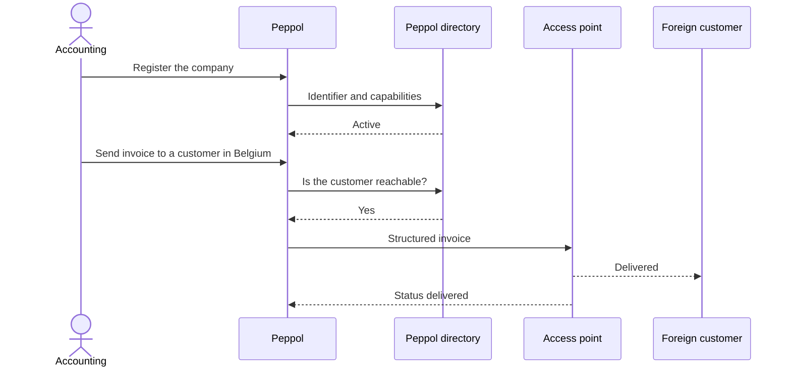

🏠 [Specs](../../../../README.md) › 🧩 [Functional capabilities](../../../README.md) ›
📒 [F8 Accounting](../../README.md) › 📝 [Use cases](../README.md) › 📝 UC-F8-38 Send and receive invoices through Peppol

# 📝 UC-F8-38 Send and receive invoices through Peppol

**Status:** ✅ specified

## Summary

Accounting sends and receives invoices through the Peppol network for exchanges with companies abroad that use it, while
exchanges between French companies stay on the approved French platforms. The company is registered as a Peppol
participant and each counterparty is looked up before sending.

## Personas

- [U05 Accounting](../../../../01-users/personas/u05-accounting.md)

## Goal

Foreign customers and suppliers on Peppol receive and send structured invoices without email, and French invoices keep
going through the French platforms.

## Trigger

An invoice is issued to, or received from, a company abroad that is on Peppol, or the company registers.

## Frequency

Registration once; invoices as they are issued or received.

## Preconditions

- The company has a legal identifier valid for the Peppol scheme
  ([E-F6-24](../../../f06-customers-and-sales/data/e-f06-24-company-identifier.md)).
- A Peppol access point is connected in the integrations hub
  [UC-F24-02](../../../f24-integrations-hub/use-cases/01-find-and-connect/uc-f24-02-connect-a-tool-in-the-fewest-steps.md)
  or offered by the company's approved platform
  ([D454](../../../../06-decisions/f08-accounting/d454-e-invoicing-platforms.md)).
- Invoices are issued as structured documents
  ([BR-F2-11](../../../f02-no-code-configuration/business-rules/br-f02-11-electronic-formats-with-the-pdf.md)).

## Postconditions

- **Succeeded:** the company is registered and its Peppol participant record is Active
  ([E-F8-42 Peppol participant](../../data/e-f08-42-peppol-participant.md)); outgoing invoices to reachable participants
  go by Peppol and incoming ones become supplier invoices.
- **Failed:** an invoice that cannot go by Peppol goes by its other channel and the reason is recorded.

## Main flow

1. Accounting registers the company on the Peppol screen
   ([S-F8-37 Peppol](../../screens/12-audit-leases-and-special-books/s-f08-37-peppol.md)) with its identifier and access
   point; the participant becomes Active once the directory confirms.
2. For an outgoing invoice, SimpleERP looks up the customer's Peppol identifier and shows whether they are reachable
   for invoices.
3. SimpleERP checks the scope
   ([BR-F8-30](../../business-rules/br-f08-30-peppol-serves-only-flows-outside-the-french-platforms.md)): a customer and
   a supplier both in France are not sent by Peppol but through the approved French platforms.
4. For a customer abroad on Peppol, SimpleERP sends the structured invoice through the access point and records the
   delivery status.
5. Incoming invoices arrive from the access point as structured documents and go to capture and matching
   [UC-F7-04](../../../f07-purchasing-and-stock/use-cases/01-procure/uc-f07-04-capture-and-match-supplier-invoices.md).
6. Accounting reads the status of every exchange and the rejections, and corrects them.

## Alternative flows

- 2a. The customer is not on Peppol: the invoice goes by email or portal as before.
- 4a. The customer rejects the invoice with a business reason: it is reopened for accounting, who issues a credit note
  and a new invoice
  [UC-F6-09](../../../f06-customers-and-sales/use-cases/03-invoice-and-get-paid/uc-f06-09-credit-note-and-refund.md).
- 5a. An incoming invoice for a French supplier arrives by Peppol: it is accepted and flagged so that accounting checks
  it is also reported through the French platform duty.

## Error flows

- 2e. The customer's identifier is unknown in the directory: the invoice is not sent and accounting is told.
- 3e. A French-to-French invoice is routed to Peppol: it is refused with the reason
  ([BR-F8-30](../../business-rules/br-f08-30-peppol-serves-only-flows-outside-the-french-platforms.md)).
- 4e. The access point rejects the document as invalid: it stays Failed with the access point's validation errors.
- Any step: a service does not answer; the call is retried first
  ([BR-F3-32](../../../f03-assistant/business-rules/br-f03-32-retry-before-an-error.md)), then the message follows the
  error pattern ([D122](../../../../06-decisions/ux/d122-error-message-standard.md)) and what the user typed stays on
  the screen.

## Business rules

- [BR-F8-30](../../business-rules/br-f08-30-peppol-serves-only-flows-outside-the-french-platforms.md)
- [BR-F8-04](../../business-rules/br-f08-04-filings-need-an-accountant.md)
- [BR-F6-12](../../../f06-customers-and-sales/business-rules/br-f06-12-public-invoices-go-through-chorus-pro-with-their-references.md)

## Entities

- [E-F8-42 Peppol participant](../../data/e-f08-42-peppol-participant.md): created, changed
- [E-F6-24](../../../f06-customers-and-sales/data/e-f06-24-company-identifier.md): read, the Peppol identifier of the
  company and its counterparties
- [E-F6-05 Invoice](../../../f06-customers-and-sales/data/e-f06-05-invoice.md): changed, the invoice's delivery status
- [E-F7-05 Supplier invoice](../../../f07-purchasing-and-stock/data/e-f07-05-supplier-invoice.md): created, an incoming
  invoice

## Permissions

Accounting registers, sends and reads exchanges; the administrator connects the access point; the owner reads the
statuses.

## Notifications

Accounting, in the app: an invoice rejected; an incoming invoice received; the registration changed state.

## Audit events

Each registration, lookup, sending, delivery status and rejection, with who or what, when and the access point's
reference.

## AI involvement

The AI assistant may explain an access point's validation error in plain words and propose the fix; accounting corrects
and resends.

## API, MCP and A2A exposure

T5 operations of the capability for the personas above: create, read, update and list. The MCP tool of the
capability may read and propose, never confirm alone. No A2A skill.

## Screens

- [S-F8-37 Peppol](../../screens/12-audit-leases-and-special-books/s-f08-37-peppol.md)

## Flowchart

See [FL-F8-12 Audit, leases and special books](../../flows/fl-f08-12-audit-leases-and-special-books.md#flowchart).

## Sequence diagram

## Acceptance criteria

1. **Given** the company's identifier and an access point **when** accounting registers **then** the participant is
   Active once the directory confirms.
2. **Given** an invoice to a customer in Belgium who is on Peppol **when** it is sent **then** it goes by Peppol and its
   delivery status is recorded.
3. **Given** an invoice between two French companies **when** it is routed to Peppol **then** it is refused and goes
   through the French platform.
4. **Given** an invalid document **when** the access point rejects it **then** it stays Failed with the validation
   errors.

## Non-functional notes

The screen answers within 2 seconds for 10,000 records; every change is audited.

## Regulatory references

France's approved e-invoicing platforms carry invoices between French companies:
[D454](../../../../06-decisions/f08-accounting/d454-e-invoicing-platforms.md),
[CR-FR-016](../../../../10-country-packs/france/invoicing/cr-fr-016-electronic-invoicing.md). Invoices between
French companies go through a registered platform (PA) chosen by the company, received from 2026-09-01 and issued from
the company's size date; Peppol does not replace that platform.

## Related use cases

- [UC-F8-37 Account for leases](uc-f08-37-account-for-leases.md)
- [UC-F8-39 Book business travel](uc-f08-39-book-business-travel.md)
- [UC-F6-19](../../../f06-customers-and-sales/use-cases/07-special-invoicing/uc-f06-19-invoice-a-public-buyer-through-chorus-pro.md)
- [UC-F7-04](../../../f07-purchasing-and-stock/use-cases/01-procure/uc-f07-04-capture-and-match-supplier-invoices.md)
- [UC-F6-28](../../../f06-customers-and-sales/use-cases/10-partners-contracts-and-warranties/uc-f06-28-keep-several-identifiers-per-company.md)

## Open questions

None.

---

⬅️ [UC-F8-37 Account for leases](uc-f08-37-account-for-leases.md) · ⬆️ [Up](README.md) ·
➡️ [UC-F8-39 Book business travel](uc-f08-39-book-business-travel.md)
