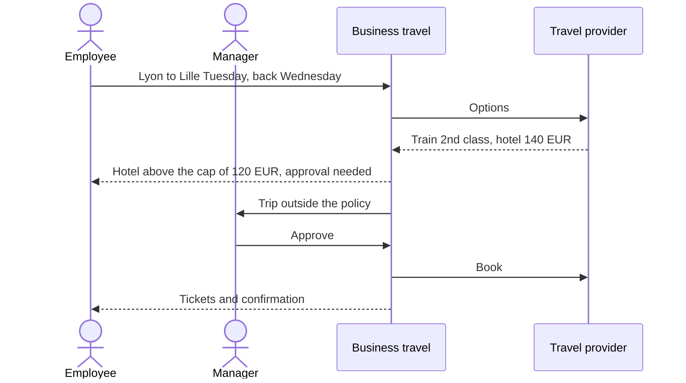

🏠 [Specs](../../../../README.md) › 🧩 [Functional capabilities](../../../README.md) ›
📒 [F8 Accounting](../../README.md) › 📝 [Use cases](../README.md) › 📝 UC-F8-39 Book business travel

# 📝 UC-F8-39 Book business travel

**Status:** 🔄 waiting for the owner

## Summary

Employees book business travel (flights, trains, hotels, cars) through SimpleERP from their phone, inside the company's
travel policy; a trip outside the policy waits for the manager's approval, and the cost flows to the expenses and the
company card.

## Personas

- [U01 Employee](../../../../01-users/personas/u01-employee.md)
- [U02 Manager](../../../../01-users/personas/u02-manager.md)

## Goal

Trips are booked quickly and within the company's rules, managers decide only on exceptions, and the costs land in the
books without retyping.

## Trigger

An employee needs to travel for work, or a manager asks them to.

## Frequency

A few trips a month per travelling employee.

## Preconditions

- The travel policy is set: allowed classes, price caps, advance booking, hotel caps
  ([BR-F8-12](../../business-rules/br-f08-12-spend-follows-limits.md)).
- A travel provider is connected in the integrations hub
  [UC-F24-02](../../../f24-integrations-hub/use-cases/01-find-and-connect/uc-f24-02-connect-a-tool-in-the-fewest-steps.md).
- The employee has a company card or an expense account ([E-F8-15 Company card](../../data/e-f08-15-company-card.md),
  [UC-F8-12](../02-purchase-to-pay/uc-f08-12-submit-and-approve-expenses.md)).

## Postconditions

- **Succeeded:** the trip is recorded ([E-F8-43 Trip](../../data/e-f08-43-trip.md)) with its legs, its cost and its
  policy check; the bookings are made; the costs flow to the expenses or the card.
- **Failed:** nothing is booked; the trip stays Draft or is Rejected with the manager's reason.

## Main flow

1. The employee opens the travel screen
   ([S-F8-38](../../screens/12-audit-leases-and-special-books/s-f08-38-business-travel.md)) on their phone and enters
   the purpose, the dates and the places.
2. SimpleERP shows the options from the provider with the policy check on each: within or outside the policy and why.
3. The employee picks the legs; a trip with any leg outside the policy is sent to the manager
   ([BR-F8-31](../../business-rules/br-f08-31-trips-outside-the-travel-policy-need-approval.md)).
4. The manager approves or rejects on their screen, with the reason; an approved trip is booked.
5. The tickets and the confirmations come back and are attached to the trip; the cost goes to the company card or to the
   employee's expense claim.
6. After the trip, the employee adds the receipts for extras, and the expense claim is submitted
   ([UC-F8-12](../02-purchase-to-pay/uc-f08-12-submit-and-approve-expenses.md)).

## Alternative flows

- 2a. The AI assistant proposes an itinerary from "Lyon to Lille Tuesday, back Wednesday" within the policy; the
  employee confirms.
- 3a. A trip within the policy is booked at once with no approval.
- 5a. A trip is changed or cancelled: the provider's conditions apply and the cost follows.

## Error flows

- 2e. No option within the policy exists for the dates: the employee may ask for an exception with a reason.
- 4e. The manager does not answer within the time: the request goes to the manager's delegate
  ([UC-F3-10](../../../f03-assistant/use-cases/10-benchmark-additions/uc-f03-10-create-and-run-ai-agents.md)).
- 5e. The provider cannot book: the trip returns to Approved and the employee is told.
- Any step: a service does not answer; the call is retried first
  ([BR-F3-32](../../../f03-assistant/business-rules/br-f03-32-retry-before-an-error.md)), then the message follows the
  error pattern ([D122](../../../../06-decisions/ux/d122-error-message-standard.md)) and what the user typed stays on
  the screen.

## Business rules

- [BR-F8-31](../../business-rules/br-f08-31-trips-outside-the-travel-policy-need-approval.md)
- [BR-F8-05](../../business-rules/br-f08-05-expenses-need-a-receipt-and-an-approval.md)
- [BR-F8-12](../../business-rules/br-f08-12-spend-follows-limits.md)

## Entities

- [E-F8-43 Trip](../../data/e-f08-43-trip.md): created, changed
- [E-F8-15 Company card](../../data/e-f08-15-company-card.md): read, the card used for payment
- [E-F8-09 Expense claim](../../data/e-f08-09-expense-claim.md): created, the expense lines of the trip
- [E-F8-16 Budget plan](../../data/e-f08-16-budget-plan.md): read, the budget of the trip

## Permissions

Employees book for themselves; managers approve their team's exceptions; accounting reads every trip; the owner reads
the totals.

## Notifications

The manager, on their phone and in the app: a trip outside the policy waits. The employee: approved, rejected, booked,
or a change by the provider.

## Audit events

Each trip created, checked against the policy, approved or rejected with the reason, booked, changed and cancelled, with
who and when.

## AI involvement

The AI assistant proposes itineraries within the policy and explains the policy check; it never books outside the policy
and never approves a trip.

## API, MCP and A2A exposure

T5 operations of the capability for the personas above: create, read, update and list. The MCP tool of the
capability may read and propose, never confirm alone. No A2A skill.

## Screens

- [S-F8-38](../../screens/12-audit-leases-and-special-books/s-f08-38-business-travel.md)

## Flowchart

See [FL-F8-12 Audit, leases and special books](../../flows/fl-f08-12-audit-leases-and-special-books.md#flowchart).

## Sequence diagram

## Acceptance criteria

1. **Given** a trip within the travel policy **when** the employee confirms **then** it is booked at once with no
   approval.
2. **Given** a hotel above the policy's cap **when** the employee confirms **then** the trip waits for the manager's
   approval.
3. **Given** a rejected trip **when** the manager rejects with a reason **then** nothing is booked and the employee is
   told why.
4. **Given** an approved and booked trip **when** the provider confirms **then** the cost goes to the company card or
   the expense claim.

## Non-functional notes

The screen answers within 2 seconds for 10,000 records; every change is audited.

## Regulatory references

Travel costs reimbursed to employees follow the expense and mileage rules:
[CR-FR-012](../../../../10-country-packs/france/tax-and-vat/cr-fr-012-mileage-scale.md). (Proposed) The carbon estimate
of a trip follows
[UC-F7-24](../../../f07-purchasing-and-stock/use-cases/09-compliance-and-carbon/uc-f07-24-measure-the-carbon-of-purchases.md).

## Related use cases

- [UC-F8-38](uc-f08-38-send-and-receive-invoices-through-peppol.md)
- [UC-F8-40 Keep cash-basis books](uc-f08-40-keep-cash-basis-books.md)
- [UC-F8-12](../02-purchase-to-pay/uc-f08-12-submit-and-approve-expenses.md)
- [UC-F8-18](../06-benchmark-additions/uc-f08-18-control-spend-with-cards-and-limits.md)
- [UC-F7-24](../../../f07-purchasing-and-stock/use-cases/09-compliance-and-carbon/uc-f07-24-measure-the-carbon-of-purchases.md)

## Open questions

None.

---

⬅️ [UC-F8-38 Send and receive invoices through Peppol](uc-f08-38-send-and-receive-invoices-through-peppol.md) ·
⬆️ [Up](README.md) · ➡️ [UC-F8-40 Keep cash-basis books](uc-f08-40-keep-cash-basis-books.md)
