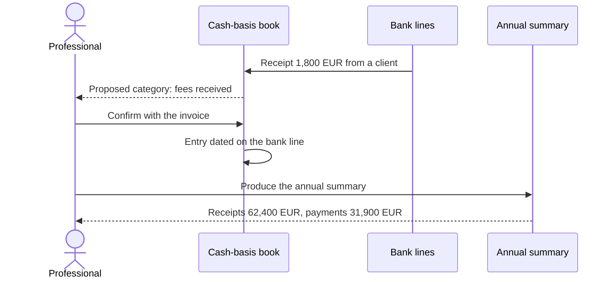

🏠 [Specs](../../../../README.md) › 🧩 [Functional capabilities](../../../README.md) ›
📒 [F8 Accounting](../../README.md) › 📝 [Use cases](../README.md) › 📝 UC-F8-40 Keep cash-basis books

# 📝 UC-F8-40 Keep cash-basis books

**Status:** 🔄 waiting for the owner

## Summary

Accounting keeps a cash-basis book for a self-employed professional or a small association: it records receipts and
payments on the date the money moves, with no receivables, payables, accruals or stock, and produces the receipts and
payments journal and the annual summary.

## Personas

- [U05 Accounting](../../../../01-users/personas/u05-accounting.md)
- [U36 Professional](../../../../01-users/personas/u36-professional.md)

## Goal

A small structure keeps simple, legal books that follow its cash, and the professional can produce them for their tax
return and their accountant.

## Trigger

A professional or an association opens its books, or a bank line is received or paid.

## Frequency

Daily or weekly entries from bank lines; a summary each year.

## Preconditions

- A book with the cash-basis framework exists ([UC-F8-15](../06-benchmark-additions/uc-f08-15-keep-several-books.md),
  [E-F8-13 Book](../../data/e-f08-13-book.md)).
- The bank accounts are connected ([UC-F8-06](../03-bank-and-collect/uc-f08-06-connect-banks-and-reconcile.md)).
- A chart of accounts suited to receipts and payments is chosen ([E-F8-01 Account](../../data/e-f08-01-account.md)).

## Postconditions

- **Succeeded:** each receipt and payment is an entry of the cash-basis book on the date of the bank line; the journal
  and the annual summary can be produced.
- **Failed:** a line without a category stays unposted in the book and is listed.

## Main flow

1. The professional (or accounting) opens the cash-basis book
   ([S-F8-39](../../screens/12-audit-leases-and-special-books/s-f08-39-cash-basis-books.md)) from the bank lines.
2. Each bank line is matched with a category (a fee received, rent paid, a purchase) and its supporting document, and
   posted on the date of the movement.
3. SimpleERP posts only receipts and payments
   ([BR-F8-32](../../business-rules/br-f08-32-cash-basis-books-record-receipts-and-payments-only.md)): an issued invoice
   or a received bill creates no entry in this book until it is paid.
4. The receipts and payments journal is kept by date, with the balance of each bank account.
5. At year end, SimpleERP produces the annual summary of receipts and payments by category, ready for the tax return.
6. The professional or their accountant ([U08](../../../../01-users/personas/u08-external-accountant.md)) reads the book
   and the summary and exports them.

## Alternative flows

- 2a. A cash receipt (a cheque or cash) is entered on the date it is received, not the date of the invoice.
- 3a. The same company also keeps an accrual book: invoices and bills are posted there, and the cash-basis book still
  posts only the money movements ([BR-F8-10](../../business-rules/br-f08-10-books-share-one-source.md)).
- 5a. A refund is entered as a negative receipt or payment of the same category.

## Error flows

- 2e. A bank line has no category: it stays unposted and is listed; the summary cannot be closed with it.
- 3e. A user tries to post an invoice or an accrual to the cash-basis book: refused with the rule
  ([BR-F8-32](../../business-rules/br-f08-32-cash-basis-books-record-receipts-and-payments-only.md)).
- 5e. A receipt is posted twice: the duplicate is detected by its bank reference and refused.
- Any step: a service does not answer; the call is retried first
  ([BR-F3-32](../../../f03-assistant/business-rules/br-f03-32-retry-before-an-error.md)), then the message follows the
  error pattern ([D122](../../../../06-decisions/ux/d122-error-message-standard.md)) and what the user typed stays on
  the screen.

## Business rules

- [BR-F8-32](../../business-rules/br-f08-32-cash-basis-books-record-receipts-and-payments-only.md)
- [BR-F8-01](../../business-rules/br-f08-01-posted-entries-never-change.md)
- [BR-F8-03](../../business-rules/br-f08-03-every-bank-line-is-reconciled.md)
- [BR-F8-10](../../business-rules/br-f08-10-books-share-one-source.md)

## Entities

- [E-F8-13 Book](../../data/e-f08-13-book.md): read, the cash-basis book
- [E-F8-04 Bank line](../../data/e-f08-04-bank-line.md): read, the bank lines
- [E-F8-03 Journal entry](../../data/e-f08-03-journal-entry.md): created, the entries of receipts and payments
- [E-F8-01 Account](../../data/e-f08-01-account.md): read, the categories

## Permissions

The professional and accounting post and read; the external accountant reads and exports; the owner of an association
reads.

## Notifications

The professional, on their phone: bank lines waiting for a category; the year-end summary is ready.

## Audit events

Each entry posted with the bank line, category and document, each refused attempt to post an accrual, each summary
produced, with who and when.

## AI involvement

The AI assistant proposes the category of each bank line from the counterparty and the history; the professional
confirms ([BR-F8-09](../../business-rules/br-f08-09-the-ai-proposes-people-post.md)).

## API, MCP and A2A exposure

T5 operations of the capability for the personas above: create, read, update and list. The MCP tool of the
capability may read and propose, never confirm alone. No A2A skill.

## Screens

- [S-F8-39](../../screens/12-audit-leases-and-special-books/s-f08-39-cash-basis-books.md)

## Flowchart

See [FL-F8-12 Audit, leases and special books](../../flows/fl-f08-12-audit-leases-and-special-books.md#flowchart).

## Sequence diagram

## Acceptance criteria

1. **Given** an invoice issued in November and paid in January **when** the books are read **then** the cash-basis book
   has the receipt in January and nothing in November.
2. **Given** a user posting an accrual **when** they save it **then** it is refused with the rule.
3. **Given** a bank line with no category **when** the summary is produced **then** the line is listed and the summary
   cannot be closed.
4. **Given** a receipt posted twice from the same bank line **when** the second is entered **then** it is refused as a
   duplicate.

## Non-functional notes

The screen answers within 2 seconds for 10,000 records; every change is audited.

## Regulatory references

Self-employed professionals in a simplified regime may keep their books on receipts and payments: the duty
and its conditions are written later as the France-pack rule on cash-basis books; this page states only what the book
records.

- France-pack rule, (Proposed) until its law is read:
  [CR-FR-217 Cash-basis books for BNC professions](../../../../10-country-packs/france/accounting/cr-fr-217-cash-basis-books-for-bnc.md)

## Related use cases

- [UC-F8-39 Book business travel](uc-f08-39-book-business-travel.md)
- [UC-F8-15 Keep several books](../06-benchmark-additions/uc-f08-15-keep-several-books.md)
- [UC-F8-06](../03-bank-and-collect/uc-f08-06-connect-banks-and-reconcile.md)
- [UC-F8-02 Post and review entries](../01-set-up-and-post/uc-f08-02-post-and-review-entries.md)

## Open questions

None.

---

⬅️ [UC-F8-39 Book business travel](uc-f08-39-book-business-travel.md) · ⬆️ [Up](README.md)
