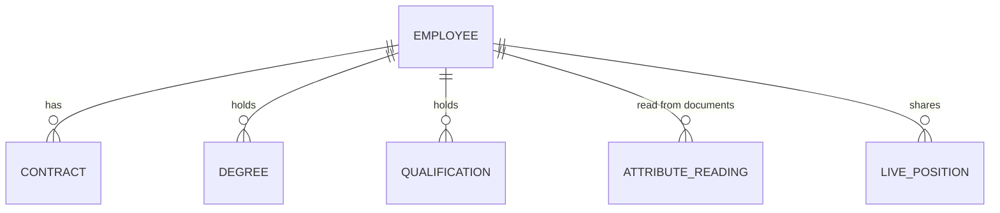
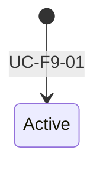

🏠 [Specs](../../../README.md) › 🧩 [Functional capabilities](../../README.md) › 👥 [F9 HR and projects](../README.md) ›
🗃️ [Data](README.md) › 🗃️ E-F9-01 Employee record

# 🗃️ E-F9-01 Employee record

**Status:** ✅ specified

## Purpose

A person employed by the company.

## Fields

| Name | Type | Required | Validation | Default | Example | Personal data | Custom fields |
|---|---|---|---|---|---|---|---|
| name | text | yes | - | - | Paul Martin | yes | yes |
| job | text | yes | - | - | Electrician | no | no |
| department, manager, coach | records | yes | - | - | Works, Marc Durand | no | no |
| private data | address, bank, family, emergency contact | no | BR-F9-01, BR-F9-02 | - | (private) | yes | no |
| skills | list of skill and level | no | skills from the catalogue | - | Wiring, expert | yes | yes |
| languages | list of language and level | no | CEFR levels A1 to C2 | - | English C1 | yes | no |
| resume | document | no | may be read by the AI, confirmed by HR (BR-F9-28) | - | resume-2026.pdf | yes | no |
| birth date | date | no | used only for the age checks (BR-F9-29) | - | 2008-03-14 | yes | no |
| medical fitness | fit, fit with restrictions, unfit | no | never a diagnosis (BR-F9-29) | - | fit with restrictions | yes | no |
| fitness restrictions, from, until | text, dates | no | when fit with restrictions | - | No loads over 15 kg | yes | no |
| home base | address | no | geocoded (REQ-T13-02) | the site's address | 12 rue Garibaldi, Lyon | yes | no |
| zones | list of zones | no | - | - | Lyon east | no | yes |
| maximum travel | minutes | no | - | none | 45 minutes | no | no |
| vehicle | company vehicle, own vehicle, none | no | - | none | Company vehicle | no | no |
| cost rate | amount per hour | no | - | from the contract | 32.00 EUR | yes | no |

The birth date and the medical fitness are seen by HR and the person only; a planner sees whether the person is eligible
and, when not, a short reason ([BR-F9-29](../business-rules/br-f09-29-planners-see-eligibility-only.md)). Degrees and
qualifications are records of their own (below); scheduling uses the attributes a request type selects
([BR-F9-25](../business-rules/br-f09-25-required-attributes-exclude.md)).

## Relations

- [E-F9-29 Degree](e-f09-29-degree.md): none, one or several (D506).
- [E-F9-12 Qualification](e-f09-12-certification.md): licences, operator certificates, authorisations, registrations.
- [E-F9-31 Attribute reading](e-f09-31-attribute-reading.md): what the AI read, to verify by HR.
- [E-F9-32 Live position](e-f09-32-live-position.md): only where the team's option is on (BR-F9-30).
- The other relations as its use cases.

## Lifecycle

## Indexes and search

By number, date, partner.

## Retention

Kept for the period of its kind of record in the France country pack, not the accounting one. See
[CR-FR-047 HR records retention](../../../10-country-packs/france/labour/cr-fr-047-hr-records-retention.md).

## Audit

Every change.

## Import and export

CSV, FEC where relevant.

## Used by

- [UC-F9-01](../use-cases/01-people/uc-f09-01-manage-employee-records-and-contracts.md)
- [UC-F9-02](../use-cases/01-people/uc-f09-02-onboard-and-offboard.md)
- [UC-F9-03](../use-cases/01-people/uc-f09-03-comply-with-french-hr-duties.md)
- [UC-F9-04](../use-cases/01-people/uc-f09-04-use-employee-self-service.md)
- [UC-F9-20 Publish the equality index and pay-transparency information](../use-cases/07-fair-pay-and-speaking-up/uc-f09-20-publish-the-equality-index-and-pay-transparency-information.md)
- [UC-F9-21 Schedule professional interviews and health visits](../use-cases/08-hr-duties/uc-f09-21-schedule-professional-interviews-and-health-visits.md)
- [UC-F9-23 Declare disability employment](../use-cases/08-hr-duties/uc-f09-23-declare-disability-employment.md)
- [UC-F9-26 Declare a work accident](../use-cases/09-train-and-protect/uc-f09-26-declare-a-work-accident.md)
- [UC-F9-28 Run engagement surveys and exit interviews](../use-cases/10-listen-to-employees/uc-f09-28-run-engagement-surveys-and-exit-interviews.md)
- [UC-F9-33 Schedule a work request](../use-cases/12-schedule-customer-requests/uc-f09-33-schedule-a-work-request.md)
- [UC-F9-38 Record degrees and qualifications](../use-cases/13-keep-qualifications/uc-f09-38-record-degrees-and-qualifications.md)
- [UC-F9-39 Read documents with the AI and verify](../use-cases/13-keep-qualifications/uc-f09-39-read-documents-and-verify.md)

## Open questions

None.

---

⬆️ [Up](README.md) · ➡️ [E-F9-02 Contract](e-f09-02-contract.md)
