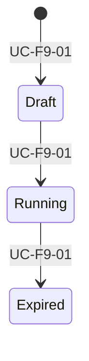

🏠 [Specs](../../../README.md) › 🧩 [Functional capabilities](../../README.md) › 👥 [F9 HR and projects](../README.md) ›
🗃️ [Data](README.md) › 🗃️ E-F9-02 Contract

# 🗃️ E-F9-02 Contract

**Status:** ✅ specified

## Purpose

An employment contract.

## Fields

| Name | Type | Required | Validation | Default | Example | Personal data | Custom fields |
|---|---|---|---|---|---|---|---|
| kind | CDI, CDD, apprenticeship, internship | yes | - | - | CDI | no | no |
| start, end | dates | yes | - | - | 2022-03-01 | no | no |
| schedule | working schedule | yes | - | 35 h | 35 h | no | no |
| collective agreement | IDCC | yes | - | - | 1597 | no | no |
| state | draft, running, expired | yes | - | draft | running | no | no |

## Relations

As its use cases.

## Lifecycle

## Indexes and search

By number, date, partner.

## Retention

Kept for the period of its kind of record in the France country pack, not the accounting one. See
[CR-FR-047 HR records retention](../../../10-country-packs/france/labour/cr-fr-047-hr-records-retention.md).

## Audit

Every change.

## Import and export

CSV, FEC where relevant.

## Used by

- [UC-F9-01](../use-cases/01-people/uc-f09-01-manage-employee-records-and-contracts.md)
- [UC-F9-07](../use-cases/02-recruit/uc-f09-07-make-an-offer-and-hire.md)

## Open questions

None.

---

⬅️ [E-F9-01 Employee record](e-f09-01-employee-record.md) · ⬆️ [Up](README.md) ·
➡️ [E-F9-03 Department](e-f09-03-department.md)
