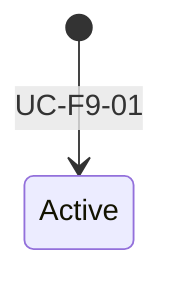

🏠 [Specs](../../../README.md) › 🧩 [Functional capabilities](../../README.md) › 👥 [F9 HR and projects](../README.md) ›
🗃️ [Data](README.md) › 🗃️ E-F9-03 Department

# 🗃️ E-F9-03 Department

**Status:** ✅ specified

## Purpose

A department with its manager.

## Fields

| Name | Type | Required | Validation | Default | Example | Personal data | Custom fields |
|---|---|---|---|---|---|---|---|
| name | text | yes | - | - | Works | no | no |
| parent | department | no | - | - | - | no | no |
| manager | employee | no | - | - | Marc Durand | no | no |

### Merged in: E-F3-23 Team

From [E-F3-23 Team](../../f03-assistant/data/e-f03-23-team.md), merged here (the owner's answer S2-9 of 2026-11-13).
The team the flow charts name with the words "team"
([FL-F3-08](../../f03-assistant/flows/fl-f03-08-manage-and-share-conversations.md)). The owner decided to create it
([D516](../../../06-decisions/foundations/d516-naming-rules-and-the-seven-classes-of-names.md)); what it holds waits for
the owner's confirmation.

## Relations

As its use cases.

## Lifecycle

## Indexes and search

By number, date, partner.

## Retention

Kept for the period of its kind of record in the France country pack, not the accounting one. See
[CR-FR-047 HR records retention](../../../10-country-packs/france/labour/cr-fr-047-hr-records-retention.md).

## Audit

Every change.

## Import and export

CSV, FEC where relevant.

## Used by

- [UC-F9-01](../use-cases/01-people/uc-f09-01-manage-employee-records-and-contracts.md)
- [UC-F3-08 Manage and share conversations](../../f03-assistant/use-cases/08-manage-and-share-conversations/uc-f03-08-manage-and-share-conversations.md)

## Open questions

None.

---

⬅️ [E-F9-02 Contract](e-f09-02-contract.md) · ⬆️ [Up](README.md) ·
➡️ [E-F9-04 Activity plan](e-f09-04-activity-plan.md)
