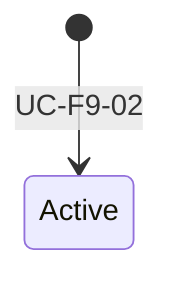

🏠 [Specs](../../../README.md) › 🧩 [Functional capabilities](../../README.md) › 👥 [F9 HR and projects](../README.md) ›
🗃️ [Data](README.md) › 🗃️ E-F9-04 Activity plan

# 🗃️ E-F9-04 Activity plan

**Status:** ✅ specified

## Purpose

An onboarding or offboarding plan.

## Fields

| Name | Type | Required | Validation | Default | Example | Personal data | Custom fields |
|---|---|---|---|---|---|---|---|
| kind | onboarding, offboarding | yes | - | - | onboarding | no | no |
| steps | email, call, meeting, to-do, document, signature | yes | - | - | Setup IT, sign the charter | no | no |
| department | department | no | - | - | Works | no | no |

## Relations

As its use cases.

## Lifecycle

## Indexes and search

By number, date, partner.

## Retention

Kept for the period of its kind of record in the France country pack, not the accounting one. See
[CR-FR-047 HR records retention](../../../10-country-packs/france/labour/cr-fr-047-hr-records-retention.md).

## Audit

Every change.

## Import and export

CSV, FEC where relevant.

## Used by

- [UC-F9-02](../use-cases/01-people/uc-f09-02-onboard-and-offboard.md)

## Open questions

None.

---

⬅️ [E-F9-03 Department](e-f09-03-department.md) · ⬆️ [Up](README.md) · ➡️ [E-F9-05 HR duty](e-f09-05-hr-duty.md)
