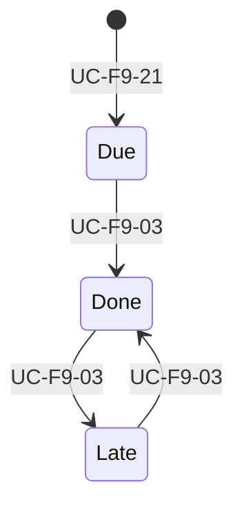

🏠 [Specs](../../../README.md) › 🧩 [Functional capabilities](../../README.md) › 👥 [F9 HR and projects](../README.md) ›
🗃️ [Data](README.md) › 🗃️ E-F9-05 HR duty

# 🗃️ E-F9-05 HR duty

**Status:** ✅ specified

## Purpose

A legal HR duty and its due date.

## Fields

| Name | Type | Required | Validation | Default | Example | Personal data | Custom fields |
|---|---|---|---|---|---|---|---|
| kind | DPAE, register entry, professional interview, 6-year review, health visit, display, BDESE | yes | - | - | professional interview | no | no |
| employee | employee | no | - | - | Paul Martin | no | no |
| due | date | yes | - | - | 2027-03-01 | no | no |
| state | due, done, late | yes | - | due | done | no | no |

## Relations

As its use cases.

## Lifecycle

## Indexes and search

By number, date, partner.

## Retention

Kept for the period of its kind of record in the France country pack, not the accounting one. See
[CR-FR-047 HR records retention](../../../10-country-packs/france/labour/cr-fr-047-hr-records-retention.md).

## Audit

Every change.

## Import and export

CSV, FEC where relevant.

## Used by

- [UC-F9-03](../use-cases/01-people/uc-f09-03-comply-with-french-hr-duties.md)
- [UC-F9-21 Schedule professional interviews and health visits](../use-cases/08-hr-duties/uc-f09-21-schedule-professional-interviews-and-health-visits.md)
- [UC-F9-22 Keep the displays and the BDESE current](../use-cases/08-hr-duties/uc-f09-22-keep-the-displays-and-the-bdese-current.md)
- [UC-F9-23 Declare disability employment](../use-cases/08-hr-duties/uc-f09-23-declare-disability-employment.md)

## Open questions

None.

---

⬅️ [E-F9-04 Activity plan](e-f09-04-activity-plan.md) · ⬆️ [Up](README.md) ·
➡️ [E-F9-06 Job position](e-f09-06-job-position.md)
