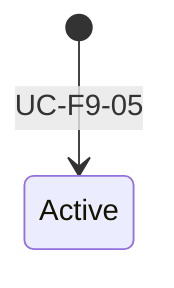

🏠 [Specs](../../../README.md) › 🧩 [Functional capabilities](../../README.md) › 👥 [F9 HR and projects](../README.md) ›
🗃️ [Data](README.md) › 🗃️ E-F9-06 Job position

# 🗃️ E-F9-06 Job position

**Status:** ✅ specified

## Purpose

A job to fill.

## Fields

| Name | Type | Required | Validation | Default | Example | Personal data | Custom fields |
|---|---|---|---|---|---|---|---|
| title | text | yes | - | - | Site manager | no | no |
| salary range | money per period | no | - | - | 42,000 to 50,000 per year | no | no |
| skills, interviewers | lists | no | - | - | - | no | no |
| published | yes or no | yes | - | no | yes | no | no |

## Relations

As its use cases.

## Lifecycle

## Indexes and search

By number, date, partner.

## Retention

Kept for the period of its kind of record in the France country pack, not the accounting one. See
[CR-FR-047 HR records retention](../../../10-country-packs/france/labour/cr-fr-047-hr-records-retention.md).

## Audit

Every change.

## Import and export

CSV, FEC where relevant.

## Used by

- [UC-F9-05](../use-cases/02-recruit/uc-f09-05-publish-jobs-and-source-candidates.md)

## Open questions

None.

---

⬅️ [E-F9-05 HR duty](e-f09-05-hr-duty.md) · ⬆️ [Up](README.md) · ➡️ [E-F9-07 Applicant](e-f09-07-applicant.md)
