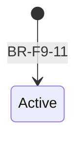

🏠 [Specs](../../../README.md) › 🧩 [Functional capabilities](../../README.md) › 👥 [F9 HR and projects](../README.md) ›
🗃️ [Data](README.md) › 🗃️ E-F9-07 Applicant

# 🗃️ E-F9-07 Applicant

**Status:** ✅ specified

## Purpose

A candidate for a job.

## Fields

| Name | Type | Required | Validation | Default | Example | Personal data | Custom fields |
|---|---|---|---|---|---|---|---|
| name, contact | text | yes | - | - | Karim B. | yes | no |
| job | job position | yes | - | - | Site manager | no | no |
| stage | stage | yes | - | new | interview | no | no |
| source | board, referral, sourcing, site | yes | - | - | LinkedIn | no | no |
| kept until | date | yes | BR-F9-11 | +2 years | 2028-11-10 | no | no |

## Relations

As its use cases.

## Lifecycle

## Indexes and search

By number, date, partner.

## Retention

Kept for the period of its kind of record in the France country pack, not the accounting one. See
[CR-FR-047 HR records retention](../../../10-country-packs/france/labour/cr-fr-047-hr-records-retention.md).

## Audit

Every change.

## Import and export

CSV, FEC where relevant.

## Used by

- [UC-F9-05](../use-cases/02-recruit/uc-f09-05-publish-jobs-and-source-candidates.md)
- [UC-F9-06](../use-cases/02-recruit/uc-f09-06-run-the-applicant-pipeline.md)
- [UC-F9-07](../use-cases/02-recruit/uc-f09-07-make-an-offer-and-hire.md)
- [UC-F9-08](../use-cases/02-recruit/uc-f09-08-run-referrals.md)

## Open questions

None.

---

⬅️ [E-F9-06 Job position](e-f09-06-job-position.md) · ⬆️ [Up](README.md) ·
➡️ [E-F9-08 Time-off allocation](e-f09-08-time-off-allocation.md)
