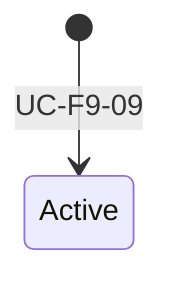

🏠 [Specs](../../../README.md) › 🧩 [Functional capabilities](../../README.md) › 👥 [F9 HR and projects](../README.md) ›
🗃️ [Data](README.md) › 🗃️ E-F9-08 Time-off allocation

# 🗃️ E-F9-08 Time-off allocation

**Status:** ✅ specified

## Purpose

Days granted to an employee.

## Fields

| Name | Type | Required | Validation | Default | Example | Personal data | Custom fields |
|---|---|---|---|---|---|---|---|
| type | time-off type | yes | - | - | Paid leave | no | no |
| kind | regular, accrual | yes | - | regular | accrual | no | no |
| days | number | yes | - | - | 25 | no | no |
| validity | dates | no | - | - | 2026-06-01 to 2027-05-31 | no | no |

## Relations

As its use cases.

## Lifecycle

## Indexes and search

By number, date, partner.

## Retention

Kept for the period of its kind of record in the France country pack, not the accounting one. See
[CR-FR-047 HR records retention](../../../10-country-packs/france/labour/cr-fr-047-hr-records-retention.md).

## Audit

Every change.

## Import and export

CSV, FEC where relevant.

## Used by

- [UC-F9-09](../use-cases/03-time/uc-f09-09-request-and-approve-time-off.md)

## Open questions

None.

---

⬅️ [E-F9-07 Applicant](e-f09-07-applicant.md) · ⬆️ [Up](README.md) ·
➡️ [E-F9-09 Time-off request](e-f09-09-time-off-request.md)
