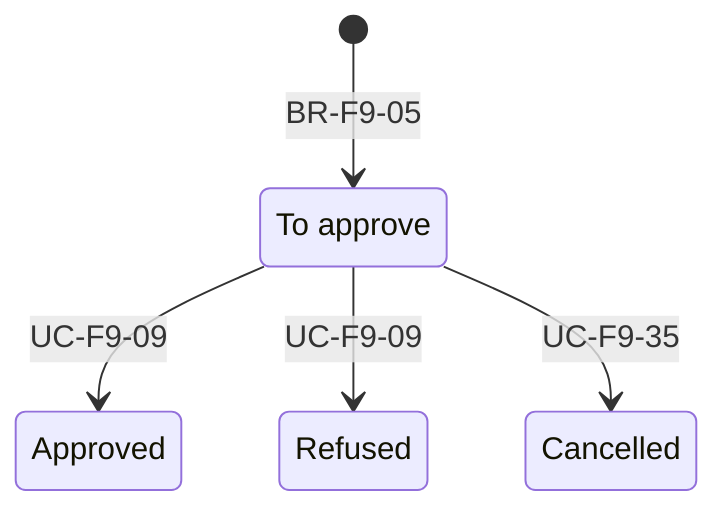

🏠 [Specs](../../../README.md) › 🧩 [Functional capabilities](../../README.md) › 👥 [F9 HR and projects](../README.md) ›
🗃️ [Data](README.md) › 🗃️ E-F9-09 Time-off request

# 🗃️ E-F9-09 Time-off request

**Status:** ✅ specified

## Purpose

A request for time off.

## Fields

| Name | Type | Required | Validation | Default | Example | Personal data | Custom fields |
|---|---|---|---|---|---|---|---|
| type | time-off type | yes | - | - | Paid leave | no | no |
| dates | range | yes | not on blackout days | - | 21 Dec to 3 Jan | no | no |
| state | to approve, approved, refused, cancelled | yes | BR-F9-05 | to approve | approved | no | no |

## Relations

As its use cases.

## Lifecycle

## Indexes and search

By number, date, partner.

## Retention

Kept for the period of its kind of record in the France country pack, not the accounting one. See
[CR-FR-047 HR records retention](../../../10-country-packs/france/labour/cr-fr-047-hr-records-retention.md).

## Audit

Every change.

## Import and export

CSV, FEC where relevant.

## Used by

- [UC-F9-09](../use-cases/03-time/uc-f09-09-request-and-approve-time-off.md)

## Open questions

None.

---

⬅️ [E-F9-08 Time-off allocation](e-f09-08-time-off-allocation.md) · ⬆️ [Up](README.md) ·
➡️ [E-F9-10 Attendance](e-f09-10-attendance.md)
