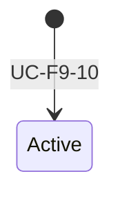

🏠 [Specs](../../../README.md) › 🧩 [Functional capabilities](../../README.md) › 👥 [F9 HR and projects](../README.md) ›
🗃️ [Data](README.md) › 🗃️ E-F9-10 Attendance

# 🗃️ E-F9-10 Attendance

**Status:** ✅ specified

## Purpose

A check-in and check-out.

## Fields

| Name | Type | Required | Validation | Default | Example | Personal data | Custom fields |
|---|---|---|---|---|---|---|---|
| employee | employee | yes | - | - | Paul Martin | yes | no |
| in, out | times | yes | - | - | 07:58 to 17:05 | no | no |
| mode | kiosk, badge, PIN, phone | yes | - | - | phone | no | no |
| position | coordinates at in and out | no | BR-F9-06 | - | (if on) | yes | no |
| overtime | hours, approved | no | BR-F9-08 | - | 1.0 | no | no |

## Relations

As its use cases.

## Lifecycle

## Indexes and search

By number, date, partner.

## Retention

Kept for the period of its kind of record in the France country pack, not the accounting one. See
[CR-FR-047 HR records retention](../../../10-country-packs/france/labour/cr-fr-047-hr-records-retention.md).

## Audit

Every change.

## Import and export

CSV, FEC where relevant.

## Used by

- [UC-F9-10](../use-cases/03-time/uc-f09-10-record-attendance-and-overtime.md)

## Open questions

None.

---

⬅️ [E-F9-09 Time-off request](e-f09-09-time-off-request.md) · ⬆️ [Up](README.md) ·
➡️ [E-F9-11 Appraisal](e-f09-11-appraisal.md)
