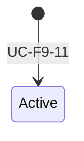

🏠 [Specs](../../../README.md) › 🧩 [Functional capabilities](../../README.md) › 👥 [F9 HR and projects](../README.md) ›
🗃️ [Data](README.md) › 🗃️ E-F9-11 Appraisal

# 🗃️ E-F9-11 Appraisal

**Status:** ✅ specified

## Purpose

An appraisal and its goals.

## Fields

| Name | Type | Required | Validation | Default | Example | Personal data | Custom fields |
|---|---|---|---|---|---|---|---|
| employee | employee | yes | - | - | Paul Martin | yes | no |
| template | template | yes | - | - | Yearly review | no | no |
| kinds | self, manager, 360 | yes | - | - | self, manager | no | no |
| goals | list | no | - | - | B2 habilitation | no | no |

## Relations

As its use cases.

## Lifecycle

## Indexes and search

By number, date, partner.

## Retention

Kept for the period of its kind of record in the France country pack, not the accounting one. See
[CR-FR-047 HR records retention](../../../10-country-packs/france/labour/cr-fr-047-hr-records-retention.md).

## Audit

Every change.

## Import and export

CSV, FEC where relevant.

## Used by

- [UC-F9-11](../use-cases/04-grow/uc-f09-11-run-appraisals-and-track-skills.md)

## Open questions

None.

---

⬅️ [E-F9-10 Attendance](e-f09-10-attendance.md) · ⬆️ [Up](README.md) ·
➡️ [E-F9-12 Qualification](e-f09-12-certification.md)
