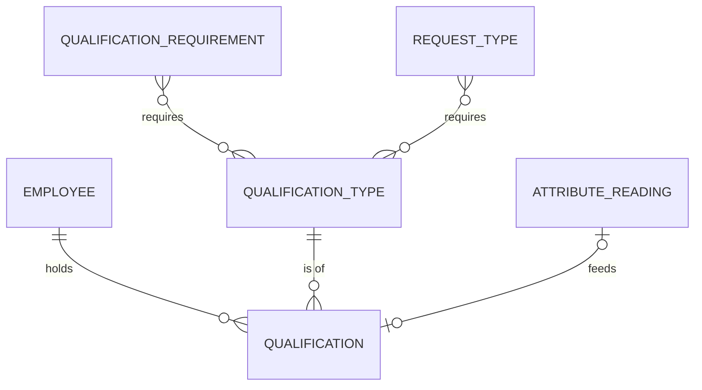
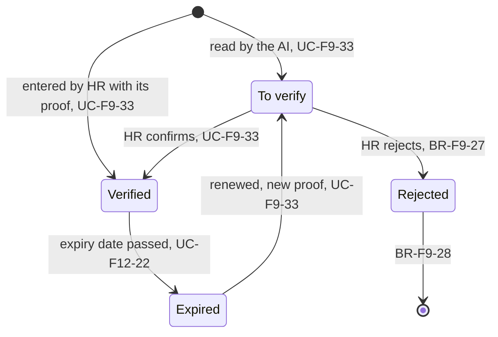

🏠 [Specs](../../../README.md) › 🧩 [Functional capabilities](../../README.md) › 👥 [F9 HR and projects](../README.md) ›
🗃️ [Data](README.md) › 🗃️ E-F9-12 Qualification

# 🗃️ E-F9-12 Qualification

**Status:** 🔄 waiting for the owner

## Purpose

A qualification an employee holds, of a type from the catalogue, with its level, its validity and its proof: a
licence, an operator certificate, an authorisation, a training, a professional registration (D506 to D509).

## Fields

| Name | Type | Required | Validation | Default | Example | Personal data | Custom fields |
|---|---|---|---|---|---|---|---|
| employee | employee | yes | - | - | Paul Martin | yes | no |
| type | qualification type (E-F9-30) | yes | from the catalogue | - | Electrical authorisation | no | no |
| level or category | from the type | when the type has levels | one of the type's levels | - | B1V | no | no |
| issued | date | no | not in the future | - | 2024-04-30 | no | no |
| expires | date | when the type has a validity | after issued; reminder 90 days before | issued + the type's validity | 2027-04-30 | no | no |
| issuer | text | no | - | - | APAVE | no | no |
| proof | document | no | - | - | habilitation-b1v.pdf | yes | no |
| status | to verify, verified, rejected, expired | yes | expired set from the expiry date | to verify | verified | no | no |
| source | by hand, AI reading | yes | - | by hand | AI reading | no | no |
| verified by, verified at | user, date and time | when verified or rejected | HR only (BR-F9-28) | - | Claire Bernard, 2026-11-13 09:12 | yes | no |

A qualification counts for scheduling only when verified and current
([BR-F9-27](../business-rules/br-f09-27-unverified-attributes-do-not-count.md)). Medical fitness is not a
qualification: it is a status on the employee (E-F9-01).

## Relations

- [E-F9-30 Qualification type](e-f09-30-qualification-type.md),
  [E-F9-31 Attribute reading](e-f09-31-attribute-reading.md).
- Required by work centres ([E-F12-17](../../f12-manufacturing/data/e-f12-17-qualification-requirement.md)) and by
  request types ([E-F2-25](../../f02-no-code-configuration/data/e-f02-25-request-type.md)).

## Lifecycle

(Proposed) A qualification entered by hand by someone other than HR starts "To verify".

## Indexes and search

By employee, type, level, status and expiry date; a facet "eligible for" in the list view.

## Retention

Kept for the period of its kind of record in the France country pack, not the accounting one. See
[CR-FR-047 HR records retention](../../../10-country-packs/france/labour/cr-fr-047-hr-records-retention.md).

## Audit

Every change, and every verification with who and when.

## Import and export

CSV; proofs as files.

## Used by

- [UC-F9-11](../use-cases/04-grow/uc-f09-11-run-appraisals-and-track-skills.md)
- [UC-F9-25 Run the training plan with OPCO funding](../use-cases/09-train-and-protect/uc-f09-25-run-the-training-plan-with-opco-funding.md)
- [UC-F12-22 Require operator qualifications per work centre](../../f12-manufacturing/use-cases/10-people-and-tools/uc-f12-22-require-operator-qualifications-per-work-centre.md)
- [UC-F9-33 Schedule a work request](../use-cases/12-schedule-customer-requests/uc-f09-33-schedule-a-work-request.md)
- [UC-F9-38 Record degrees and qualifications](../use-cases/13-keep-qualifications/uc-f09-38-record-degrees-and-qualifications.md)
- [UC-F9-39 Read documents with the AI and verify](../use-cases/13-keep-qualifications/uc-f09-39-read-documents-and-verify.md)

## Open questions

None.

---

⬅️ [E-F9-11 Appraisal](e-f09-11-appraisal.md) · ⬆️ [Up](README.md) ·
➡️ [E-F9-13 Company vehicle](e-f09-13-company-vehicle.md)
