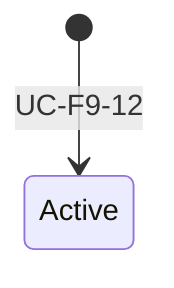

🏠 [Specs](../../../README.md) › 🧩 [Functional capabilities](../../README.md) › 👥 [F9 HR and projects](../README.md) ›
🗃️ [Data](README.md) › 🗃️ E-F9-13 Company vehicle

# 🗃️ E-F9-13 Company vehicle

**Status:** ✅ specified

## Purpose

A company vehicle.

## Fields

| Name | Type | Required | Validation | Default | Example | Personal data | Custom fields |
|---|---|---|---|---|---|---|---|
| plate | text | yes | unique | - | GH-421-KL | no | no |
| driver | employee | no | - | - | Paul Martin | no | no |
| contracts | leasing, service | no | expiry alerts | - | Leasing to 2028 | no | no |
| costs | list | no | - | - | fuel, repairs | no | no |

## Relations

As its use cases.

## Lifecycle

## Indexes and search

By number, date, partner.

## Retention

Kept for the period of its kind of record in the France country pack, not the accounting one. See
[CR-FR-047 HR records retention](../../../10-country-packs/france/labour/cr-fr-047-hr-records-retention.md).

## Audit

Every change.

## Import and export

CSV, FEC where relevant.

## Used by

- [UC-F9-12](../use-cases/05-workplace-services/uc-f09-12-manage-the-fleet.md)

## Open questions

None.

---

⬅️ [E-F9-12 Qualification](e-f09-12-certification.md) · ⬆️ [Up](README.md) ·
➡️ [E-F9-14 Approval request](e-f09-14-approval-request.md)
