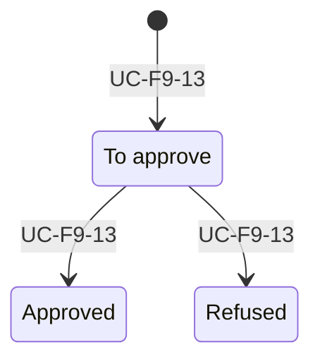

🏠 [Specs](../../../README.md) › 🧩 [Functional capabilities](../../README.md) › 👥 [F9 HR and projects](../README.md) ›
🗃️ [Data](README.md) › 🗃️ E-F9-14 Approval request

# 🗃️ E-F9-14 Approval request

**Status:** ✅ specified

## Purpose

A request needing approval.

## Fields

| Name | Type | Required | Validation | Default | Example | Personal data | Custom fields |
|---|---|---|---|---|---|---|---|
| type | approval type | yes | - | - | Remote day | no | no |
| requester | employee | yes | - | - | Léa Moreau | no | no |
| approvers | users | yes | - | - | Marc Durand | no | no |
| state | to approve, approved, refused | yes | - | to approve | approved | no | no |

## Relations

As its use cases.

## Lifecycle

## Indexes and search

By number, date, partner.

## Retention

Kept for the period of its kind of record in the France country pack, not the accounting one. See
[CR-FR-047 HR records retention](../../../10-country-packs/france/labour/cr-fr-047-hr-records-retention.md).

## Audit

Every change.

## Import and export

CSV, FEC where relevant.

## Used by

- [UC-F9-13](../use-cases/05-workplace-services/uc-f09-13-request-approvals-and-order-lunch.md)

## Open questions

None.

---

⬅️ [E-F9-13 Company vehicle](e-f09-13-company-vehicle.md) · ⬆️ [Up](README.md) ·
➡️ [E-F9-15 Visitor](e-f09-15-visitor.md)
