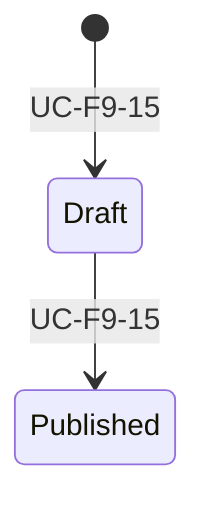

🏠 [Specs](../../../README.md) › 🧩 [Functional capabilities](../../README.md) › 👥 [F9 HR and projects](../README.md) ›
🗃️ [Data](README.md) › 🗃️ E-F9-16 Shift

# 🗃️ E-F9-16 Shift

**Status:** ✅ specified

## Purpose

A planned shift.

## Fields

| Name | Type | Required | Validation | Default | Example | Personal data | Custom fields |
|---|---|---|---|---|---|---|---|
| resource | employee or equipment | yes | no overlap (BR-F9-09) | - | Paul Martin | no | no |
| role | role | yes | - | - | Electrician | no | no |
| time | range | yes | - | - | Mon 7:30 to 16:30 | no | no |
| state | draft, published | yes | - | draft | published | no | no |

## Relations

As its use cases.

## Lifecycle

## Indexes and search

By number, date, partner.

## Retention

Kept for the period of its kind of record in the France country pack, not the accounting one. See
[CR-FR-047 HR records retention](../../../10-country-packs/france/labour/cr-fr-047-hr-records-retention.md).

## Audit

Every change.

## Import and export

CSV, FEC where relevant.

## Used by

- [UC-F9-15](../use-cases/06-plan-and-deliver-work/uc-f09-15-plan-shifts.md)
- [UC-F9-30 Plan rounds and optimise routes](../use-cases/11-capacity-rounds-and-partners/uc-f09-30-plan-rounds-and-optimise-routes.md)

## Open questions

None.

---

⬅️ [E-F9-15 Visitor](e-f09-15-visitor.md) · ⬆️ [Up](README.md) ·
➡️ [E-F9-17 Timesheet line](e-f09-17-timesheet-line.md)
