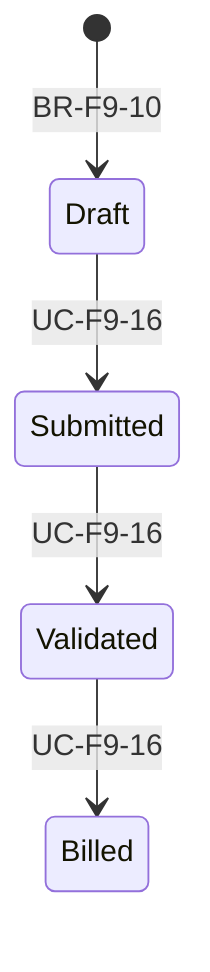

🏠 [Specs](../../../README.md) › 🧩 [Functional capabilities](../../README.md) › 👥 [F9 HR and projects](../README.md) ›
🗃️ [Data](README.md) › 🗃️ E-F9-17 Timesheet line

# 🗃️ E-F9-17 Timesheet line

**Status:** ✅ specified

## Purpose

Time spent on a task.

## Fields

| Name | Type | Required | Validation | Default | Example | Personal data | Custom fields |
|---|---|---|---|---|---|---|---|
| employee | employee | yes | - | - | Paul Martin | no | no |
| project, task | records | yes | - | - | Villeurbanne, wiring | no | no |
| hours | number | yes | - | - | 7.5 | no | no |
| state | draft, submitted, validated, billed | yes | BR-F9-10 | draft | validated | no | no |

## Relations

As its use cases.

## Lifecycle

## Indexes and search

By number, date, partner.

## Retention

Kept for the period of its kind of record in the France country pack, not the accounting one. See
[CR-FR-047 HR records retention](../../../10-country-packs/france/labour/cr-fr-047-hr-records-retention.md).

## Audit

Every change.

## Import and export

CSV, FEC where relevant.

## Used by

- [UC-F9-16](../use-cases/03-time/uc-f09-16-record-and-validate-timesheets.md)

## Open questions

None.

---

⬅️ [E-F9-16 Shift](e-f09-16-shift.md) · ⬆️ [Up](README.md) ·
➡️ [E-F9-18 Project and task](e-f09-18-project-and-task.md)
