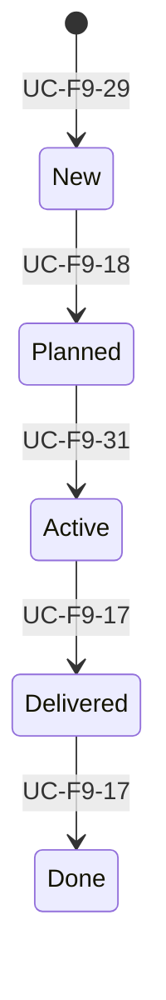

🏠 [Specs](../../../README.md) › 🧩 [Functional capabilities](../../README.md) › 👥 [F9 HR and projects](../README.md) ›
🗃️ [Data](README.md) › 🗃️ E-F9-18 Project and task

# 🗃️ E-F9-18 Project and task

**Status:** ✅ specified

## Purpose

A project and its tasks.

## Fields

| Name | Type | Required | Validation | Default | Example | Personal data | Custom fields |
|---|---|---|---|---|---|---|---|
| project | text | yes | - | - | Villeurbanne, 40 flats | no | yes |
| tasks | list with stage, assignees, dependencies | yes | no loop | - | Wiring, floor 2 | no | yes |
| milestones | list | no | - | - | Electrics done | no | no |
| budget | money | no | - | - | 120,000 | no | no |
| worksheet | form, signature | no | for field tasks | - | Boiler check | maybe | no |

## Relations

As its use cases.

## Lifecycle

## Indexes and search

By number, date, partner.

## Retention

Kept for the period of its kind of record in the France country pack, not the accounting one. See
[CR-FR-047 HR records retention](../../../10-country-packs/france/labour/cr-fr-047-hr-records-retention.md).

## Audit

Every change.

## Import and export

CSV, FEC where relevant.

## Used by

- [UC-F9-17](../use-cases/06-plan-and-deliver-work/uc-f09-17-manage-projects-and-tasks.md)
- [UC-F9-18](../use-cases/06-plan-and-deliver-work/uc-f09-18-run-field-service.md)
- [UC-F9-29 Plan capacity across projects](../use-cases/11-capacity-rounds-and-partners/uc-f09-29-plan-capacity-across-projects.md)
- [UC-F9-31 Follow a project as a customer](../use-cases/11-capacity-rounds-and-partners/uc-f09-31-follow-a-project-as-a-customer.md)
- [UC-F9-32 Work with subcontractors and freelancers on projects](../use-cases/11-capacity-rounds-and-partners/uc-f09-32-work-with-subcontractors-and-freelancers-on-projects.md)

## Open questions

None.

---

⬅️ [E-F9-17 Timesheet line](e-f09-17-timesheet-line.md) · ⬆️ [Up](README.md) ·
➡️ [E-F9-19 Contract template](e-f09-19-contract-template.md)
