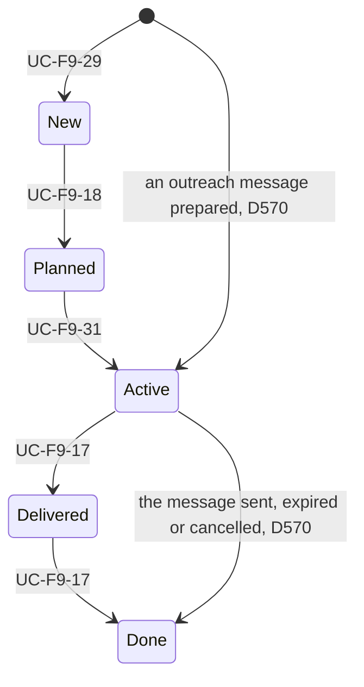

🏠 [Specs](../../../README.md) › 🧩 [Functional capabilities](../../README.md) › 👥 [F9 HR and projects](../README.md) ›
🗃️ [Data](README.md) › 🗃️ E-F9-18 Project and task

# 🗃️ E-F9-18 Project and task

**Status:** ✅ specified

## Purpose

A project and its tasks.

## Fields

| Name | Type | Required | Validation | Default | Example | Personal data | Custom fields |
|---|---|---|---|---|---|---|---|
| project | text | yes, except for a task an outreach sequence creates | - | - | Villeurbanne, 40 flats | no | yes |
| tasks | list with stage, assignees, dependencies | yes | no loop | - | Wiring, floor 2 | no | yes |
| milestones | list | no | - | - | Electrics done | no | no |
| budget | money | no | - | - | 120,000 | no | no |
| worksheet | form, signature | no | for field tasks | - | Boiler check | maybe | no |

### Task created by an outreach sequence

In prepared mode, each LinkedIn message an outreach sequence must send waits as a task in the task list of the HR user
who owns the sequence, outside any project, and the task carries Send
([D570](../../../06-decisions/f09-hr-and-projects/d570-linkedin-sending-prepared-by-default.md),
[UC-F9-41](../use-cases/02-recruit/uc-f09-41-run-a-linkedin-outreach-sequence.md)).

| Name | Type | Required | Validation | Default | Example | Personal data | Custom fields |
|---|---|---|---|---|---|---|---|
| prepared outreach message | outreach message (E-F9-47) | for a task an outreach sequence creates | one prepared message per task; the task shows its text and Send, which sends it through Unipile within the account's limits (BR-F9-41) | - | Follow-up 1 to Julien R., site manager | yes | no |
| assignee | user | for a task an outreach sequence creates | the HR user who owns the sequence, or the one who took it over | the sequence's owner | Claire P. | yes | no |
| due, expires at | date and time | for a task an outreach sequence creates | the message's prepared at and expires at, 7 days later (D570) | - | 2026-11-10 09:30, 2026-11-17 09:30 | no | no |
| outcome | sent, expired, cancelled | once the task is closed | as the message's status | - | sent | no | no |

## Relations

As its use cases. A task an outreach sequence creates carries one
[E-F9-47 Outreach message](e-f09-47-outreach-message.md).

## Lifecycle

A task an outreach sequence creates starts Active and closes as Done with its outcome: sent on HR's click, expired after
7 days, or cancelled by a reply, a refusal or day 60
([BR-F9-37](../business-rules/br-f09-37-outreach-stops-at-a-reply-a-refusal-or-day-60.md)).

## Indexes and search

By number, date, partner.

## Retention

Kept for the period of its kind of record in the France country pack, not the accounting one. See
[CR-FR-047 HR records retention](../../../10-country-packs/france/labour/cr-fr-047-hr-records-retention.md). A task an
outreach sequence creates is erased with its message and its prospect
([BR-F9-39](../business-rules/br-f09-39-prospects-kept-only-as-long-as-needed.md)).

## Audit

Every change.

## Import and export

CSV, FEC where relevant.

## Used by

- [UC-F9-17](../use-cases/06-plan-and-deliver-work/uc-f09-17-manage-projects-and-tasks.md)
- [UC-F9-18](../use-cases/06-plan-and-deliver-work/uc-f09-18-run-field-service.md)
- [UC-F9-29 Plan capacity across projects](../use-cases/11-capacity-rounds-and-partners/uc-f09-29-plan-capacity-across-projects.md)
- [UC-F9-31 Follow a project as a customer](../use-cases/11-capacity-rounds-and-partners/uc-f09-31-follow-a-project-as-a-customer.md)
- [UC-F9-32 Work with subcontractors and freelancers on projects](../use-cases/11-capacity-rounds-and-partners/uc-f09-32-work-with-subcontractors-and-freelancers-on-projects.md)
- [UC-F9-41 Run a LinkedIn outreach sequence](../use-cases/02-recruit/uc-f09-41-run-a-linkedin-outreach-sequence.md)
- [UC-F9-42 Turn a positive reply into an applicant](../use-cases/02-recruit/uc-f09-42-turn-a-positive-reply-into-an-applicant.md)

## Open questions

None.

---

⬅️ [E-F9-17 Timesheet line](e-f09-17-timesheet-line.md) · ⬆️ [Up](README.md) ·
➡️ [E-F9-19 Contract template](e-f09-19-contract-template.md)
