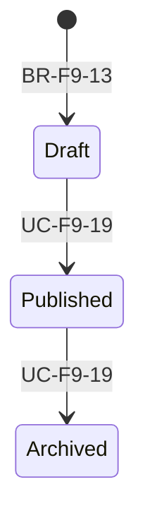

🏠 [Specs](../../../README.md) › 🧩 [Functional capabilities](../../README.md) › 👥 [F9 HR and projects](../README.md) ›
🗃️ [Data](README.md) › 🗃️ E-F9-19 Contract template

# 🗃️ E-F9-19 Contract template

**Status:** ✅ specified

## Purpose

A contract template made of articles.

## Fields

| Name | Type | Required | Validation | Default | Example | Personal data | Custom fields |
|---|---|---|---|---|---|---|---|
| name | text | yes | unique | - | CDI electrician | no | no |
| kind | CDI, CDD, apprenticeship, amendment | yes | - | - | CDI | no | no |
| articles | ordered list from the clause library | yes | BR-F9-13 | - | Trial period, Pay, Working time | no | no |
| legal check | ok, warnings, blocking | yes | BR-F9-13 | - | ok | no | no |
| state | draft, published, archived | yes | no publish if blocking | draft | published | no | no |

## Relations

As its use cases.

## Lifecycle

## Indexes and search

By number, date, partner.

## Retention

Kept for the period of its kind of record in the France country pack, not the accounting one. See
[CR-FR-047 HR records retention](../../../10-country-packs/france/labour/cr-fr-047-hr-records-retention.md).

## Audit

Every change.

## Import and export

CSV, FEC where relevant.

## Used by

- [UC-F9-19](../use-cases/01-people/uc-f09-19-edit-contract-templates.md)

## Open questions

None.

---

⬅️ [E-F9-18 Project and task](e-f09-18-project-and-task.md) · ⬆️ [Up](README.md) ·
➡️ [E-F9-20 Equality index](e-f09-20-equality-index.md)
