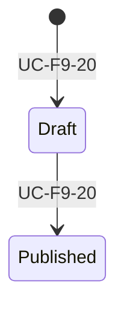

🏠 [Specs](../../../README.md) › 🧩 [Functional capabilities](../../README.md) › 👥 [F9 HR and projects](../README.md) ›
🗃️ [Data](README.md) › 🗃️ E-F9-20 Equality index

# 🗃️ E-F9-20 Equality index

**Status:** ✅ specified

## Purpose

A year's equality index, pay gaps per category and measures.

## Fields

| Name | Type | Required | Validation | Default | Example | Personal data | Custom fields |
|---|---|---|---|---|---|---|---|
| year | year | yes | - | - | 2026 | no | - |
| indicators and score | points | yes | - | - | 84/100 | no | - |
| gaps per category | percent | yes | - | - | technicians 6 % | no | - |
| measures | text, owners, dates | no | - | - | raise review 2027 | no | - |
| published | date | no | - | - | 2027-02-20 | no | - |

## Relations

Computed from payroll (F13) and Employees.

## Lifecycle

Draft, published, declared.

## Indexes and search

By year.

## Retention

10 years.

## Audit

Computed, published.

## Import and export

None.

## Used by

- [UC-F9-20 Publish the equality index and pay-transparency information](../use-cases/07-fair-pay-and-speaking-up/uc-f09-20-publish-the-equality-index-and-pay-transparency-information.md)

## Open questions

None.

---

⬅️ [E-F9-19 Contract template](e-f09-19-contract-template.md) · ⬆️ [Up](README.md) ·
➡️ [E-F9-21 Whistleblowing report](e-f09-21-whistleblowing-report.md)
