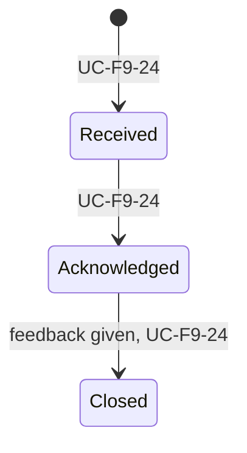

🏠 [Specs](../../../README.md) › 🧩 [Functional capabilities](../../README.md) › 👥 [F9 HR and projects](../README.md) ›
🗃️ [Data](README.md) › 🗃️ E-F9-21 Whistleblowing report

# 🗃️ E-F9-21 Whistleblowing report

**Status:** 🔄 waiting for the owner

## Purpose

A report with its facts, files, handler and dates, identity protected.

## Fields

| Name | Type | Required | Validation | Default | Example | Personal data | Custom fields |
|---|---|---|---|---|---|---|---|
| code | text | yes | unique | - | 7KQ2-M9 | no | - |
| reporter | identity or anonymous | no | handlers only | - | anonymous | yes | - |
| facts and files | text, files | yes | - | - | ... | yes | - |
| acknowledged, feedback | dates | no | 7 days, 3 months | - | 11-15, 01-20 | no | - |

## Relations

Handled by named Users.

## Lifecycle

## Indexes and search

By code, for handlers.

## Retention

(Proposed) to read: as the law sets after closing.

## Audit

Every access.

## Import and export

None.

## Used by

- [UC-F9-24 Receive and handle a whistleblowing report](../use-cases/07-fair-pay-and-speaking-up/uc-f09-24-receive-and-handle-a-whistleblowing-report.md)

## Open questions

None.

---

⬅️ [E-F9-20 Equality index](e-f09-20-equality-index.md) · ⬆️ [Up](README.md) ·
➡️ [E-F9-22 Training session](e-f09-22-training-session.md)
