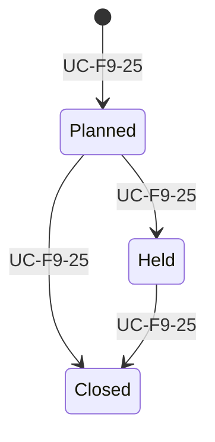

🏠 [Specs](../../../README.md) › 🧩 [Functional capabilities](../../README.md) › 👥 [F9 HR and projects](../README.md) ›
🗃️ [Data](README.md) › 🗃️ E-F9-22 Training session

# 🗃️ E-F9-22 Training session

**Status:** 🔄 waiting for the owner

## Purpose

A planned training with its trainees, cost and funding.

## Fields

| Name | Type | Required | Validation | Default | Example | Personal data | Custom fields |
|---|---|---|---|---|---|---|---|
| course | text | yes | - | - | Driver continuous training | no | - |
| trainees | employees | yes | - | - | 6 drivers | yes | - |
| dates and provider | dates, supplier | yes | - | - | 2027-01-18, AFTRAL | no | - |
| cost and funding | amounts per funder | yes | - | - | OPCO 3,000, company 1,200 | no | - |
| attendance | per trainee | no | - | - | 6 present | yes | - |

## Relations

Updates Qualifications (E-F9-12).

## Lifecycle

Planned, funded, held, closed.

## Indexes and search

By course and year.

## Retention

6 years (Proposed).

## Audit

Planned, funded, attended.

## Import and export

None.

## Used by

- [UC-F9-25 Run the training plan with OPCO funding](../use-cases/09-train-and-protect/uc-f09-25-run-the-training-plan-with-opco-funding.md)

## Open questions

None.

---

⬅️ [E-F9-21 Whistleblowing report](e-f09-21-whistleblowing-report.md) · ⬆️ [Up](README.md) ·
➡️ [E-F9-23 Work accident](e-f09-23-work-accident.md)
