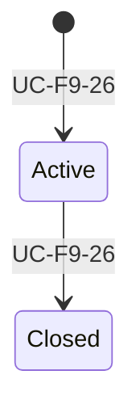

🏠 [Specs](../../../README.md) › 🧩 [Functional capabilities](../../README.md) › 👥 [F9 HR and projects](../README.md) ›
🗃️ [Data](README.md) › 🗃️ E-F9-23 Work accident

# 🗃️ E-F9-23 Work accident

**Status:** 🔄 waiting for the owner

## Purpose

An accident at work or on the way, its declaration and leave.

## Fields

| Name | Type | Required | Validation | Default | Example | Personal data | Custom fields |
|---|---|---|---|---|---|---|---|
| employee | employee | yes | - | - | Paul Morel | yes | - |
| when, where | date and time, place | yes | - | - | 2026-11-12 10:30, Lyon 3 | no | - |
| what happened | text | yes | - | - | Fall from a ladder | yes | - |
| declared | date and time | no | within 48 h | - | 2026-11-13 09:00 | no | - |
| leave | dates | no | - | - | until 11-26 | yes | - |

## Relations

Linked to a Risk assessment line.

## Lifecycle

Reported, declared, closed.

## Indexes and search

By employee, site, year.

## Retention

(Proposed) to read: as HR records.

## Audit

Reported, declared, closed.

## Import and export

None.

## Used by

- [UC-F9-26 Declare a work accident](../use-cases/09-train-and-protect/uc-f09-26-declare-a-work-accident.md)

## Open questions

None.

---

⬅️ [E-F9-22 Training session](e-f09-22-training-session.md) · ⬆️ [Up](README.md) ·
➡️ [E-F9-24 Risk assessment line](e-f09-24-risk-assessment-line.md)
