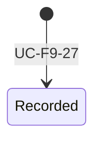

🏠 [Specs](../../../README.md) › 🧩 [Functional capabilities](../../README.md) › 👥 [F9 HR and projects](../README.md) ›
🗃️ [Data](README.md) › 🗃️ E-F9-24 Risk assessment line

# 🗃️ E-F9-24 Risk assessment line

**Status:** 🔄 waiting for the owner

## Purpose

A risk of a work unit with its rating and prevention actions.

## Fields

| Name | Type | Required | Validation | Default | Example | Personal data | Custom fields |
|---|---|---|---|---|---|---|---|
| work unit | site or team | yes | - | - | Site teams | no | - |
| hazard | text | yes | - | - | Work at height | no | - |
| severity, likelihood | 1 to 4 | yes | - | - | 4, 3 | no | - |
| actions | owner, date | no | - | - | Platform ladders by 01-31 | no | - |
| version | date | yes | - | - | 2026-11-20 | no | - |

## Relations

Linked to Work accidents.

## Lifecycle

Versioned.

## Indexes and search

By work unit.

## Retention

40 years (Proposed) to read.

## Audit

Versions.

## Import and export

None.

## Used by

- [UC-F9-27 Keep the occupational risk assessment](../use-cases/09-train-and-protect/uc-f09-27-keep-the-occupational-risk-assessment.md)

## Open questions

None.

---

⬅️ [E-F9-23 Work accident](e-f09-23-work-accident.md) · ⬆️ [Up](README.md) ·
➡️ [E-F9-25 Resource allocation](e-f09-25-resource-allocation.md)
