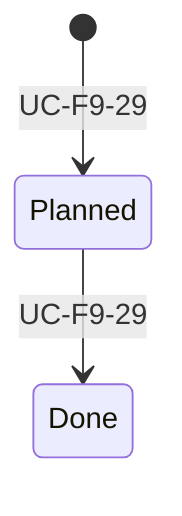

🏠 [Specs](../../../README.md) › 🧩 [Functional capabilities](../../README.md) › 👥 [F9 HR and projects](../README.md) ›
🗃️ [Data](README.md) › 🗃️ E-F9-25 Resource allocation

# 🗃️ E-F9-25 Resource allocation

**Status:** ✅ specified

## Purpose

Hours of a person planned on a project for a week.

## Fields

| Name | Type | Required | Validation | Default | Example | Personal data | Custom fields |
|---|---|---|---|---|---|---|---|
| person | employee | yes | - | - | Lea Roux | yes | - |
| project | project | yes | - | - | ERP Durand | no | - |
| week, hours | week, hours | yes | within capacity or reason | - | w50, 30 h | no | - |

## Relations

Between Employees and Projects (E-F9-18).

## Lifecycle

Planned, moved, done.

## Indexes and search

By person, project and week.

## Retention

As the project.

## Audit

Changes.

## Import and export

None.

## Used by

- [UC-F9-29 Plan capacity across projects](../use-cases/11-capacity-rounds-and-partners/uc-f09-29-plan-capacity-across-projects.md)

## Open questions

None.

---

⬅️ [E-F9-24 Risk assessment line](e-f09-24-risk-assessment-line.md) · ⬆️ [Up](README.md) ·
➡️ [E-F9-26 Round](e-f09-26-round.md)
