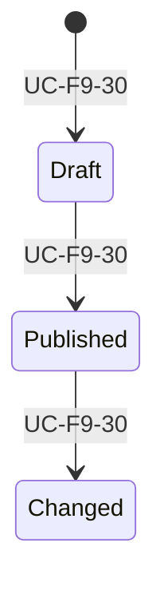

🏠 [Specs](../../../README.md) › 🧩 [Functional capabilities](../../README.md) › 👥 [F9 HR and projects](../README.md) ›
🗃️ [Data](README.md) › 🗃️ E-F9-26 Round

# 🗃️ E-F9-26 Round

**Status:** ✅ specified

## Purpose

An ordered list of visits or deliveries for one person on one day, with travel times.

## Fields

| Name | Type | Required | Validation | Default | Example | Personal data | Custom fields |
|---|---|---|---|---|---|---|---|
| person | employee | yes | - | - | Lea (carer) | yes | - |
| day | date | yes | - | - | 2026-12-08 | no | - |
| stops | ordered visits with times | yes | within windows | - | 9 visits | yes | - |
| travel | minutes and km | yes | - | - | 84 min, 41 km | no | - |
| status | draft, published, changed | yes | - | draft | published | no | - |

### Sector extension: SC04 Home care

From [E-SC04-05 Round](../../../08-sectors/sc04-home-care/data/e-sc04-05-round.md), merged here
([D517](../../../06-decisions/foundations/d517-the-drafts-open-points-answered-on-2026-11-13.md), S0). A carer's day.

| Name | Type | Required | Validation | Default | Example | Personal data | Custom fields |
|---|---|---|---|---|---|---|---|
| carer, date | records | yes | unique pair | - | N. R., 11 Nov | yes | no |
| visits, travel | list, minutes | yes | BR-SC04-05 | - | 6, 95 min | no | no |

## Relations

Holds Shifts or Field tasks; built by the optimiser.

## Lifecycle

Draft, published, done.

## Indexes and search

By person and day.

## Retention

As the visits it holds.

## Audit

Optimised, changed, published.

## Import and export

None.

## Used by

- [UC-F9-30 Plan rounds and optimise routes](../use-cases/11-capacity-rounds-and-partners/uc-f09-30-plan-rounds-and-optimise-routes.md)
- [UC-SC04-03 Plan visits and optimise rounds](../../../08-sectors/sc04-home-care/use-cases/02-plan-the-rounds/uc-sc04-03-plan-visits-and-optimise-rounds.md)
- [UC-SC04-06 Replace an absent carer](../../../08-sectors/sc04-home-care/use-cases/02-plan-the-rounds/uc-sc04-06-replace-an-absent-carer.md)
- [UC-SC04-11 Pay carers' travel time and split shifts](../../../08-sectors/sc04-home-care/use-cases/04-bill-and-fund/uc-sc04-11-pay-carers-travel-time-and-split-shifts.md)
- [UC-SC04-15 Ask the AI assistant about the rounds](../../../08-sectors/sc04-home-care/use-cases/03-visit/uc-sc04-15-ask-the-assistant-about-the-rounds.md)

## Open questions

None.

---

⬅️ [E-F9-25 Resource allocation](e-f09-25-resource-allocation.md) · ⬆️ [Up](README.md) ·
➡️ [E-F9-27 Subcontractor assignment](e-f09-27-subcontractor-assignment.md)
