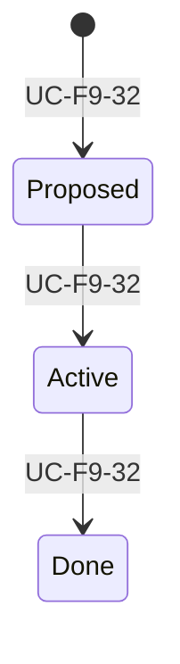

🏠 [Specs](../../../README.md) › 🧩 [Functional capabilities](../../README.md) › 👥 [F9 HR and projects](../README.md) ›
🗃️ [Data](README.md) › 🗃️ E-F9-27 Subcontractor assignment

# 🗃️ E-F9-27 Subcontractor assignment

**Status:** ✅ specified

## Purpose

A subcontractor or freelancer on a project with scope, price and documents.

## Fields

| Name | Type | Required | Validation | Default | Example | Personal data | Custom fields |
|---|---|---|---|---|---|---|---|
| supplier | supplier | yes | - | - | SARL Volt | no | - |
| project and scope | project, text | yes | - | - | Lot 4 electricity | no | - |
| price | amount | yes | - | - | 18,000 EUR | no | - |
| documents | files with dates | yes | current | - | URSSAF 2026-09 | no | - |
| progress | percent or hours | no | - | - | 50 % | no | - |

## Relations

On a Project (E-F9-18); invoices matched in F7.

## Lifecycle

Proposed, active, done.

## Indexes and search

By project and supplier.

## Retention

10 years from the end of the fiscal year, as a supporting document of the invoices
([CR-FR-002](../../../10-country-packs/france/accounting/cr-fr-002-accounting-records-kept-ten-years.md)).

## Audit

Added, documents, progress.

## Import and export

None.

## Used by

- [UC-F9-32 Work with subcontractors and freelancers on projects](../use-cases/11-capacity-rounds-and-partners/uc-f09-32-work-with-subcontractors-and-freelancers-on-projects.md)

## Open questions

None.

---

⬅️ [E-F9-26 Round](e-f09-26-round.md) · ⬆️ [Up](README.md) ·
➡️ [E-F9-28 Assignment proposal](e-f09-28-assignment-proposal.md)
