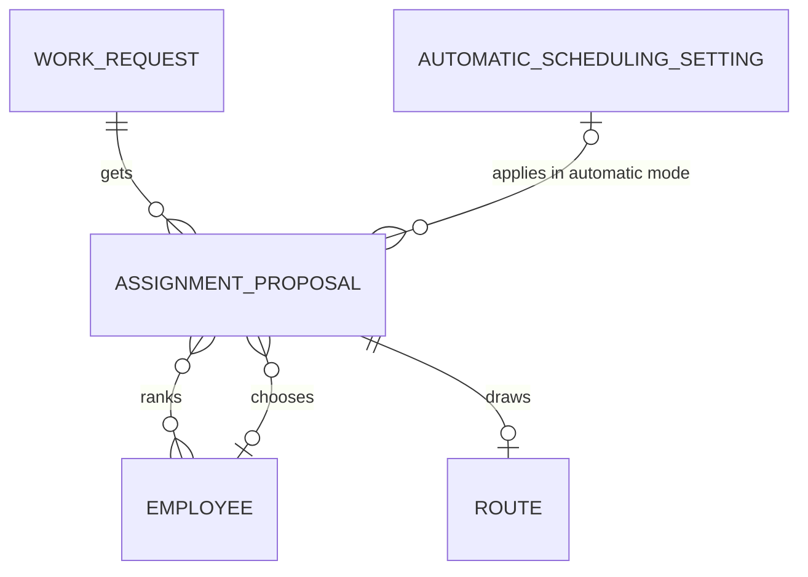
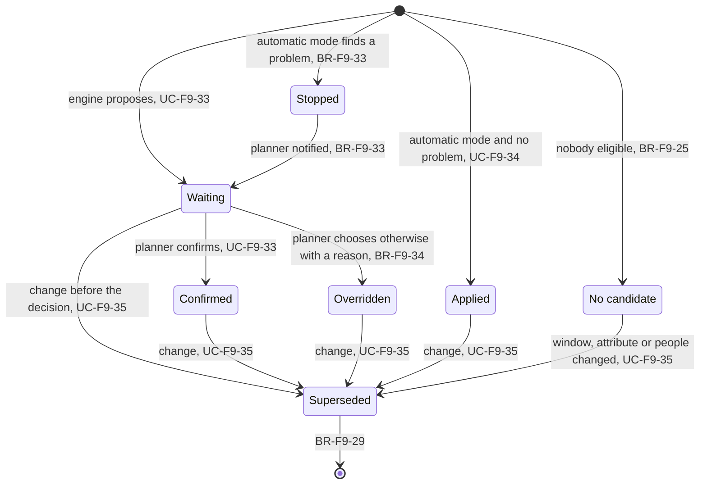

🏠 [Specs](../../../README.md) › 🧩 [Functional capabilities](../../README.md) › 👥 [F9 HR and projects](../README.md) ›
🗃️ [Data](README.md) › 🗃️ E-F9-28 Assignment proposal

# 🗃️ E-F9-28 Assignment proposal

**Status:** ✅ specified

## Purpose

What the scheduling engine found for one work request: the best candidate, the next ones with their scores and reasons,
the people excluded and why, and the route on the map. By default the planner confirms, edits or overrides it; in
automatic mode the engine applies it, and stops and notifies the planner at the first problem (decided by the owner on
2026-11-13, VD-33).

## Fields

| Name | Type | Required | Validation | Default | Example | Personal data | Custom fields |
|---|---|---|---|---|---|---|---|
| work request | E-F16-12 | yes | - | - | WR-2026-004812 | no | - |
| mode | proposed, automatic | yes | automatic only if allowed | proposed | proposed | no | - |
| computed at | date and time | yes | - | now | 2026-12-01 14:02 | no | - |
| candidates | ranked list, see below | no | eligible people only | - | Lea 87, Marc 74 | yes | - |
| excluded | list of person and reason | no | reasons as eligibility labels | - | Paul: licence expired | yes | - |
| chosen | employee | no | an eligible candidate | the first | Lea (carer) | yes | - |
| route | E-T13-02 | no | - | - | 12 min, 6 km | no | - |
| problem | list | no | see below | - | no eligible person | no | - |
| state | list | yes | the lifecycle below | waiting | confirmed | no | - |
| decided by | user or engine | no | - | - | Claire (coordinator) | yes | - |
| override reason | text | yes when overridden | not empty | - | Customer asked for Marc | maybe | - |
| notified | users | no | the planners of the team | - | Claire | yes | - |

Each candidate row: person, total score (0 to 100, D517), the preferred attributes met, travel time, lateness,
continuity, fairness and cost as the request type weighs them (VD-32).

Problems that stop automatic mode (from the scheduling flow chart): no eligible person, a legal conflict, the window
missed, over the cost limit, an overlap.

The planner sees each exclusion as an eligibility label only, such as "not eligible: medical restriction", "not
eligible: under 18" or "not eligible: licence expired", never the birth date or the fitness details
([BR-F9-29](../business-rules/br-f09-29-planners-see-eligibility-only.md)).

## Relations

- [E-F16-12 Work request](../../f16-customer-support-agents/data/e-f16-12-work-request.md)
- [E-F9-01 Employee record](e-f09-01-employee-record.md)
- [E-T13-02 Route](../../../03-technical/t13-maps-and-geodata/data/e-t13-02-route.md)
- [E-F9-33 Automatic scheduling setting](e-f09-33-automatic-scheduling-setting.md)
- Applied to the person's day as a [E-F9-26 Round](e-f09-26-round.md) stop or a [E-F9-16 Shift](e-f09-16-shift.md).

## Lifecycle

The screens show the states as: Waiting, No candidate, Applied, Stopped, Confirmed, Overridden, Superseded.

## Indexes and search

- By work request, state, mode, chosen person, date.
- Facets: state, mode, problem, request type.

## Retention

As its work request. The candidates' scores and the exclusions of people not chosen are reduced to
counts after 1 year; the override reasons stay in the audit trail.

## Audit

Computed (inputs and engine version), confirmed, edited, overridden with its reason (BR-F9-34), applied automatically,
stopped with its problem, superseded.

## Import and export

None; the list view exports the decisions, without the exclusion reasons.

## Used by

- [UC-F9-33 Schedule a work request](../use-cases/12-schedule-customer-requests/uc-f09-33-schedule-a-work-request.md)
- [UC-F9-34](../use-cases/12-schedule-customer-requests/uc-f09-34-run-the-automatic-scheduling.md)
- [UC-F9-35 Re-plan after a change](../use-cases/12-schedule-customer-requests/uc-f09-35-re-plan-after-a-change.md)

## Open questions

None.

---

⬅️ [E-F9-27 Subcontractor assignment](e-f09-27-subcontractor-assignment.md) · ⬆️ [Up](README.md) ·
➡️ [E-F9-29 Degree](e-f09-29-degree.md)
