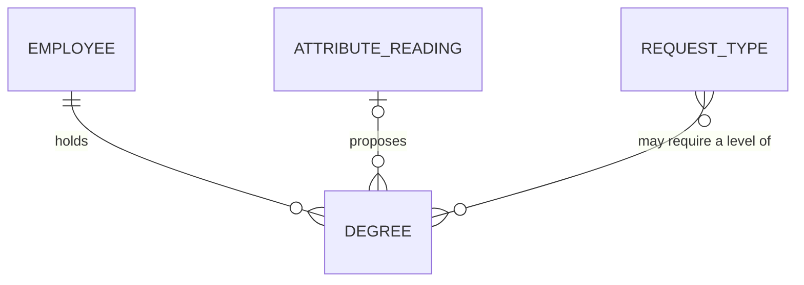
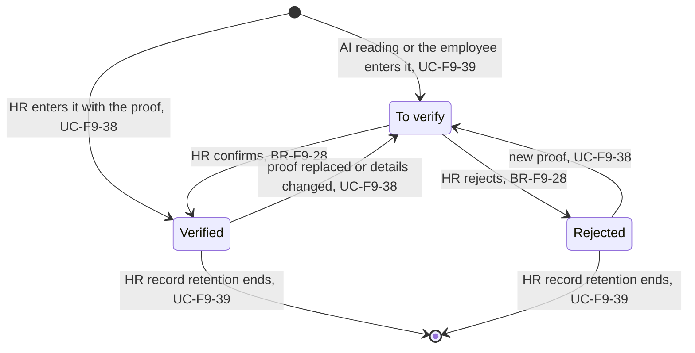

🏠 [Specs](../../../README.md) › 🧩 [Functional capabilities](../../README.md) › 👥 [F9 HR and projects](../README.md) ›
🗃️ [Data](README.md) › 🗃️ E-F9-29 Degree

# 🗃️ E-F9-29 Degree

**Status:** ✅ specified

## Purpose

A degree an employee holds. The field is optional and structured: an employee has none, one or several. It is entered
by hand or read by the AI from a document; an AI reading counts only once HR has confirmed it (decided by the owner on
2026-11-13, VD-24 to VD-26).

## Fields

| Name | Type | Required | Validation | Default | Example | Personal data | Custom fields |
|---|---|---|---|---|---|---|---|
| employee | employee | yes | - | - | Lea Bernard | yes | - |
| title | text | yes | - | - | Diplôme d'État d'accompagnant éducatif et social | yes | - |
| EQF level | 1 to 8 | no | - | - | 3 | yes | - |
| national level | country pack's list | no | RNCP level in France | - | 3 | yes | - |
| field of study | text | no | - | - | Social care | yes | - |
| institution | text | no | - | - | IRTS Lyon | yes | - |
| country | country | no | ISO 3166 | company's | France | yes | - |
| year | year | no | not in the future | - | 2019 | yes | - |
| proof | document | no | PDF or image | - | diploma-scan.pdf | yes | - |
| status | list | yes | to verify, verified, rejected | to verify | verified | no | - |
| source | by hand, AI reading | yes | - | by hand | AI reading | no | - |
| reading | E-F9-31 | when read by the AI | - | - | Reading 771 | no | - |
| verified by, at | user, date | when verified | HR only | - | Nadia (HR), 2026-11-20 | yes | - |

## Relations

- [E-F9-01 Employee record](e-f09-01-employee-record.md)
- [E-F9-31 Attribute reading](e-f09-31-attribute-reading.md)
- [E-F2-25 Request type](../../f02-no-code-configuration/data/e-f02-25-request-type.md): a request type may require or
  prefer a minimum level or a field of study (family "degrees and qualifications", VD-27).

## Lifecycle

Only a verified degree counts for scheduling
([BR-F9-27](../business-rules/br-f09-27-unverified-attributes-do-not-count.md)). A degree HR enters with its
proof is verified at once; one the employee enters waits for HR.

## Indexes and search

- By employee, title, EQF level, national level, field of study, status.
- Facets: status, EQF level, source.
- Planners see only whether a person is eligible
  ([BR-F9-29](../business-rules/br-f09-29-planners-see-eligibility-only.md)).

## Retention

Kept for the period of HR records in the France country pack. See
[CR-FR-047 HR records retention](../../../10-country-packs/france/labour/cr-fr-047-hr-records-retention.md).

## Audit

Every change; read by the AI, confirmed, corrected, rejected, with who and when.

## Import and export

- CSV import of degrees, each imported row "to verify".
- Part of the employee's data export (access requests, CR-FR-051).

## Used by

- [UC-F9-38](../use-cases/13-keep-qualifications/uc-f09-38-record-degrees-and-qualifications.md)
- [UC-F9-39](../use-cases/13-keep-qualifications/uc-f09-39-read-documents-and-verify.md)
- [UC-F9-33 Schedule a work request](../use-cases/12-schedule-customer-requests/uc-f09-33-schedule-a-work-request.md)

## Open questions

None.

---

⬅️ [E-F9-28 Assignment proposal](e-f09-28-assignment-proposal.md) · ⬆️ [Up](README.md) ·
➡️ [E-F9-30 Qualification type](e-f09-30-qualification-type.md)
