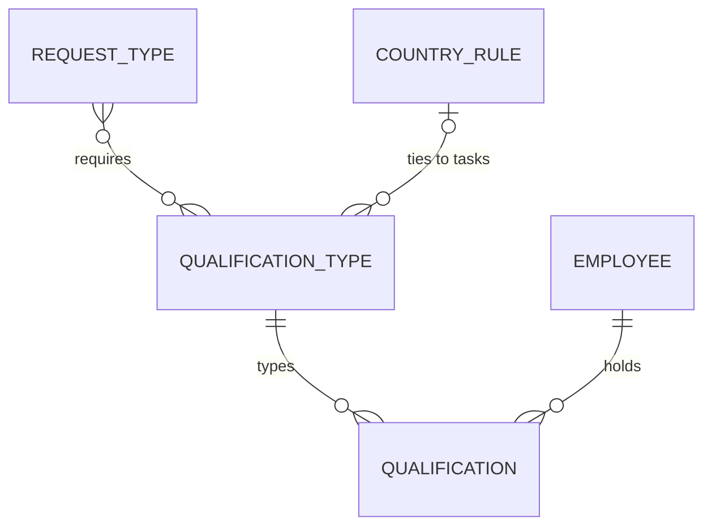
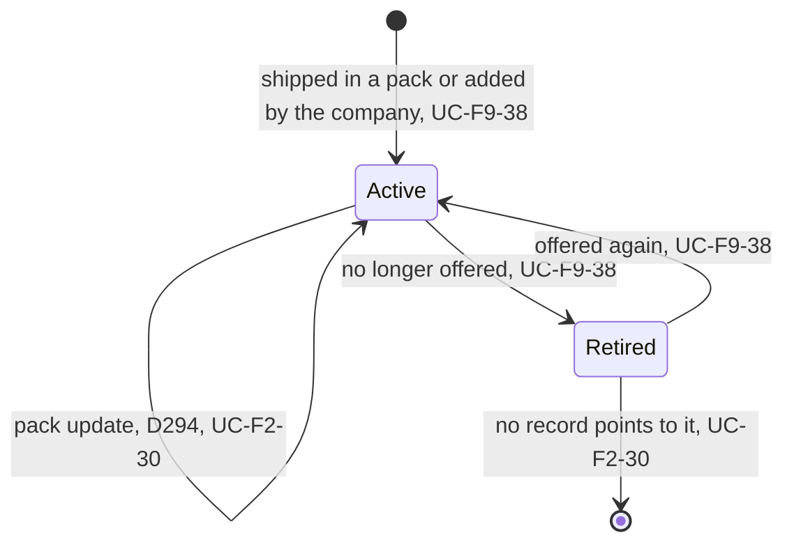

🏠 [Specs](../../../README.md) › 🧩 [Functional capabilities](../../README.md) › 👥 [F9 HR and projects](../README.md) ›
🗃️ [Data](README.md) › 🗃️ E-F9-30 Qualification type

# 🗃️ E-F9-30 Qualification type

**Status:** ✅ specified

## Purpose

One kind of qualification an employee may hold, from a catalogue: its levels or categories, how long it stays valid,
and the tasks the law ties to it. The catalogues are YAML files shipped in the country packs and the sector packs; a
company may add its own types. Each qualification record (E-F9-12, generalised from Certification) points to one type.

## Fields

| Name | Type | Required | Validation | Default | Example | Personal data | Custom fields |
|---|---|---|---|---|---|---|---|
| code | text | yes | unique in the catalogue | - | fr.food-hygiene | no | - |
| name | text, per language | yes | - | - | Food hygiene training | no | - |
| kind | list | yes | see below | - | training | no | - |
| levels or categories | list | no | - | none | B0, B1V, B2V, BR | no | - |
| validity | months, or none | no | - | none | none | no | - |
| reminder | days before expiry | no | - | 90 | 90 | no | - |
| tasks tied | list of task or operation codes | no | - | none | kitchen work | no | - |
| legal | yes or no | yes | yes only from a country pack | no | yes | no | - |
| country rule | country rule | when legal | - | - | CR-FR-110 | no | - |
| source | country pack, sector pack, company | yes | - | company | France country pack | no | - |
| proof expected | text | no | - | - | Training certificate | no | - |
| status | list | yes | active, retired | active | active | no | - |

Kinds: licence, operator certificate, electrical authorisation, training, professional registration, professional card,
medical fitness, other.

Examples drawn from the specs (the France catalogue itself is listed in
[CR-FR-210](../../../10-country-packs/france/labour/cr-fr-210-qualifications-tied-to-tasks.md)):
- food hygiene training for a commercial restaurant, at least 14 hours, no renewal
  ([CR-FR-110](../../../10-country-packs/france/hospitality/cr-fr-110-food-hygiene-records.md));
- the operating permit for selling alcohol, valid 10 years
  ([CR-FR-109](../../../10-country-packs/france/hospitality/cr-fr-109-alcohol-licences.md));
- drivers' initial qualification and continuous training
  ([CR-FR-119](../../../10-country-packs/france/transport/cr-fr-119-driver-training.md));
- the estate agent's professional card, renewed every 3 years
  ([CR-FR-139](../../../10-country-packs/france/real-estate/cr-fr-139-hoguet-card-and-guarantee.md)).

Medical fitness is a type of its own whose levels are fit, fit with restrictions and unfit; the record holds the status,
its dates and the restrictions, never a diagnosis
([CR-FR-209](../../../10-country-packs/france/labour/cr-fr-209-reinforced-medical-follow-up.md)).

## Relations

- [E-F9-12 Certification](e-f09-12-certification.md), generalised into Qualification (change note of step S4b).
- [E-F2-25 Request type](../../f02-no-code-configuration/data/e-f02-25-request-type.md): requires or prefers types.
- A legal type is always required where the law ties it to the task
  ([BR-F9-26](../business-rules/br-f09-26-legal-requirements-never-relaxed.md)).

## Lifecycle

A pack update that changes a legal type flags the requirements that use it and warns the administrators (D294).
A company may retire only the types it added; a legal type follows its pack.

## Indexes and search

- Unique: code.
- Search: name in every language.
- Facets: kind, source, legal, status.

## Retention

As the pack that ships it; a company's own type as long as a qualification record points to it.

## Audit

Added, changed, retired; pack updates with their version.

## Import and export

YAML catalogues in the country and sector packs; a company exports and imports its own types as YAML.

## Used by

- [UC-F9-38](../use-cases/13-keep-qualifications/uc-f09-38-record-degrees-and-qualifications.md)
- [UC-F2-30](../../f02-no-code-configuration/use-cases/12-set-up-request-types/uc-f02-30-set-up-a-request-type.md)
- [UC-F9-33 Schedule a work request](../use-cases/12-schedule-customer-requests/uc-f09-33-schedule-a-work-request.md)

## Open questions

None.

---

⬅️ [E-F9-29 Degree](e-f09-29-degree.md) · ⬆️ [Up](README.md) ·
➡️ [E-F9-31 Attribute reading](e-f09-31-attribute-reading.md)
