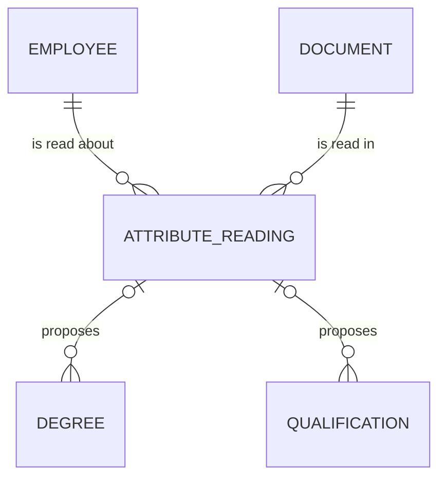
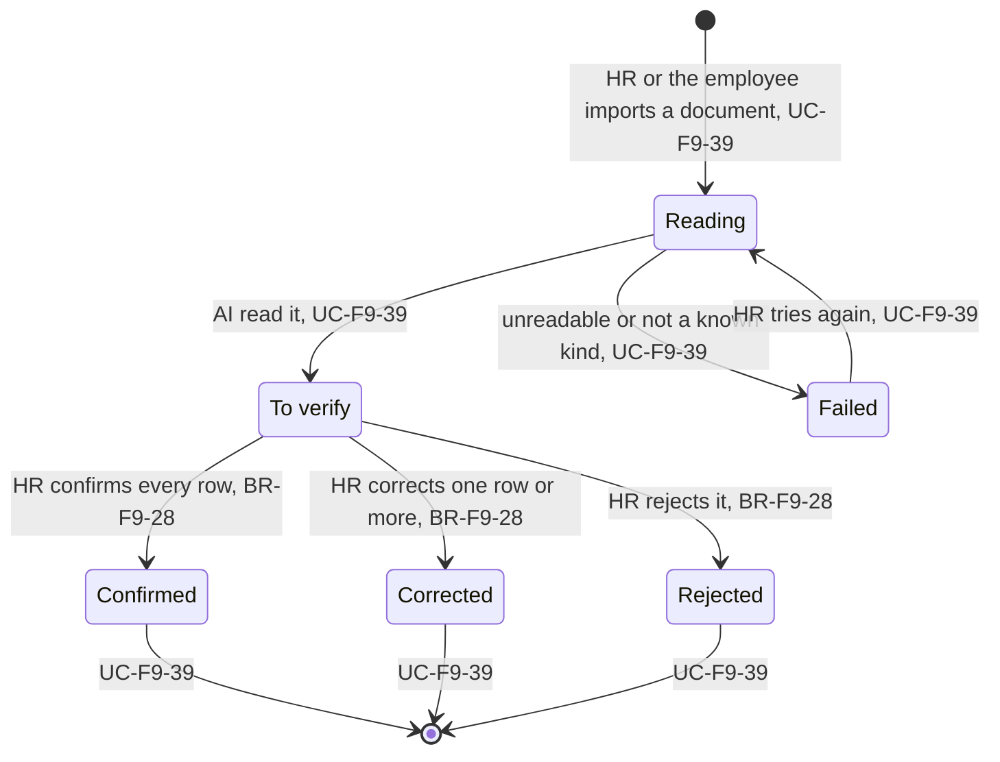

🏠 [Specs](../../../README.md) › 🧩 [Functional capabilities](../../README.md) › 👥 [F9 HR and projects](../README.md) ›
🗃️ [Data](README.md) › 🗃️ E-F9-31 Attribute reading

# 🗃️ E-F9-31 Attribute reading

**Status:** ✅ specified

## Purpose

What the AI read from one document about an employee: the degrees, qualifications, skills and languages it found, each
with its confidence. HR confirms, corrects or rejects each reading with the source document beside it; until then the
attributes stay "to verify" and scheduling ignores them (decided by the owner on 2026-11-13, VD-25 and VD-26). The
employee is told what was read.

## Fields

| Name | Type | Required | Validation | Default | Example | Personal data | Custom fields |
|---|---|---|---|---|---|---|---|
| employee | employee | yes | - | - | Lea Bernard | yes | - |
| document | document | yes | PDF or image | - | cv-lea-bernard.pdf | yes | - |
| document kind | list | yes | see below | AI's guess | CV | no | - |
| fields read | list of rows, see below | no | - | - | 2 degrees, 3 languages | yes | - |
| confidence | percent | yes | lowest of the rows; a field under 80 % is marked for HR (D517) | - | 81 % | no | - |
| model | AI model | yes | T7 gateway | company's default | - | no | - |
| status | list | yes | the lifecycle below | reading | to verify | no | - |
| reviewer | user | when reviewed | HR only | - | Nadia (HR) | yes | - |
| reviewed at | date and time | when reviewed | - | - | 2026-11-20 10:12 | no | - |
| employee told at | date and time | when reviewed | - | - | 2026-11-20 10:12 | no | - |
| failure | text | when failed | - | - | Page unreadable | no | - |

Document kinds (VD-25): CV or résumé, diploma scan or photo, licence or certificate, training record.

Each row read: the target (degree, qualification, skill, language), the values found (title, type, level, dates,
issuer), the confidence, the place in the document, and the decision (confirmed, corrected, rejected).

## Relations

- [E-F9-01 Employee record](e-f09-01-employee-record.md)
- [E-F9-29 Degree](e-f09-29-degree.md) and [E-F9-12 Certification](e-f09-12-certification.md) (generalised into
  Qualification): each row confirmed creates or updates one, as verified.
- The document is an HR document (E-F2-13 Document) with its retention.
- The AI call goes through the T7 gateway and is metered like every AI assistant call.

## Lifecycle

## Indexes and search

- By employee, status, document kind, reviewer, date.
- The "Readings to verify" list: status to verify, oldest first.

## Retention

A confirmed or corrected reading is kept as the HR records it fed
([CR-FR-047](../../../10-country-packs/france/labour/cr-fr-047-hr-records-retention.md)). A rejected or failed reading
is deleted 3 months after its decision; the document follows its own retention.

## Audit

Read (model and prompt version), each row confirmed, corrected or rejected with the reviewer, the employee told.

## Import and export

Documents imported one by one or in bulk; no export of the readings themselves, only of the attributes they
fed.

## Used by

- [UC-F9-39](../use-cases/13-keep-qualifications/uc-f09-39-read-documents-and-verify.md)
- [UC-F9-38](../use-cases/13-keep-qualifications/uc-f09-38-record-degrees-and-qualifications.md)

## Open questions

None.

---

⬅️ [E-F9-30 Qualification type](e-f09-30-qualification-type.md) · ⬆️ [Up](README.md) ·
➡️ [E-F9-32 Live position](e-f09-32-live-position.md)
