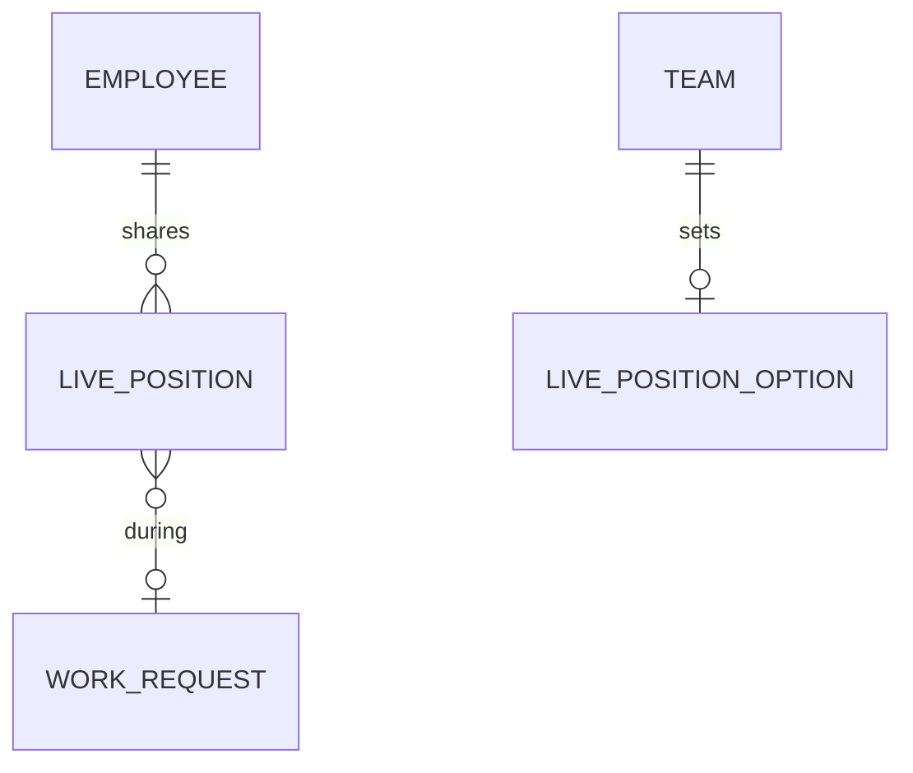
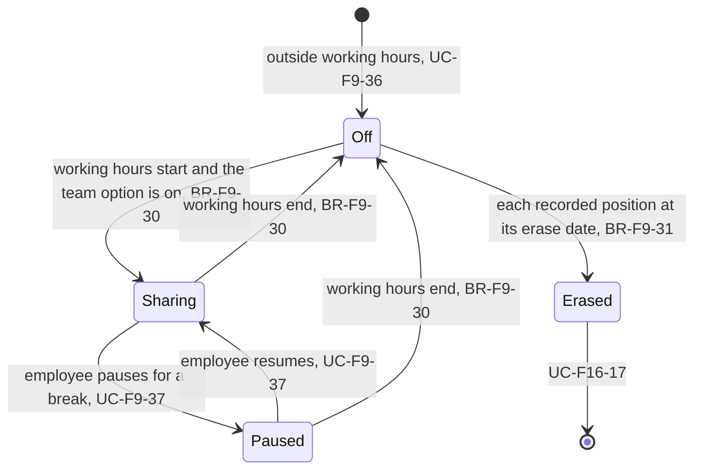

🏠 [Specs](../../../README.md) › 🧩 [Functional capabilities](../../README.md) › 👥 [F9 HR and projects](../README.md) ›
🗃️ [Data](README.md) › 🗃️ E-F9-32 Live position

# 🗃️ E-F9-32 Live position

**Status:** 🔄 draft (GH-2 step S4b, from VD-21, VD-22, VD-23 / D503, D504, D505)

## Purpose

An employee's position recorded during working hours, when their team has the live-position option. The option exists
for drivers (SC07) and carers (SC04) only, with its purpose and impact assessment; it is off outside working hours and
never used for speed or performance. The default stays the position at check-in and check-out
([BR-F9-06](../business-rules/br-f09-06-location-only-at-check-in.md)). The employee sees a live indicator, what is
recorded, who sees it, and may pause it during breaks (decided by the owner on 2026-11-13, VD-21 to VD-23).

## Fields

| Name | Type | Required | Validation | Default | Example | Personal data | Custom fields |
|---|---|---|---|---|---|---|---|
| employee | employee | yes | team has the option on | - | Lea Bernard | yes | no |
| team | team | yes | - | - | Carers Lyon east | no | no |
| purpose | list | yes | the team setting's | - | planning of the next visit | no | no |
| recorded at | date and time | yes | within working hours | now | 2026-12-08 10:41:05 | yes | no |
| position | coordinates | yes | - | - | 45.7578, 4.8320 | yes | no |
| accuracy | metres | yes | - | - | 12 | no | no |
| work in hand | work request or round stop | no | - | - | WR-2026-004812 | no | no |
| sharing | sharing, paused | yes | - | sharing | sharing | yes | no |
| erased on | date | yes | 2 months at most (D517) | recorded at + 2 months | 2027-02-08 | no | no |

No speed, heading or score field exists, and none is computed from the positions (VD-22).

Purposes the team setting may state: safety, planning of the next visit, proof of service when nothing else proves it.

## Relations

- [E-F9-01 Employee record](e-f09-01-employee-record.md)
- [E-F16-12 Work request](../../f16-customer-support-agents/data/e-f16-12-work-request.md): the work in hand, which
  gives the customer an arrival time during the visit's window; that time is computed and never stored.
- [E-F9-10 Attendance](e-f09-10-attendance.md): the check-in and check-out positions, kept apart and for 1 year (D290).

Who sees it ([BR-F9-32](../business-rules/br-f09-32-who-sees-a-position.md)): the employee's planner or dispatcher and
their manager, for planning only; the customer, the arrival time only; the employee, everything shared about them.

## Lifecycle

Nothing is recorded while Off or Paused. The phone shows the live indicator in Sharing and Paused.

## Indexes and search

- By employee and time; by team and time for the planning map.
- No search across employees outside the teams the viewer plans or manages.

## Retention

Erased 2 months at most after recording
([BR-F9-31](../business-rules/br-f09-31-live-positions-kept-two-months.md), D517; the CNIL guidance to read in
[CR-FR-211](../../../10-country-packs/france/data-protection/cr-fr-211-live-geolocation-of-employees.md)).

## Audit

Option switched on or off for a team (by whom, purpose, impact assessment attached), every pause and resume, every view
of a person's positions by someone other than the employee.

## Import and export

No import. The employee exports their own history (access request,
[CR-FR-051](../../../10-country-packs/france/data-protection/cr-fr-051-access-and-erasure.md)); no other export.

## Used by

- [UC-F9-37](../use-cases/12-schedule-customer-requests/uc-f09-37-share-my-position-during-work.md)
- [UC-F9-36](../use-cases/12-schedule-customer-requests/uc-f09-36-see-work-and-places-on-a-map.md)
- [UC-F16-17](../../f16-customer-support-agents/use-cases/06-take-in-every-request/uc-f16-17-follow-the-arrival-of-a-visit.md)

## Open questions

None.

---

⬅️ [E-F9-31 Attribute reading](e-f09-31-attribute-reading.md) · ⬆️ [Up](README.md) ·
➡️ [E-F9-33 Automatic scheduling setting](e-f09-33-automatic-scheduling-setting.md)
