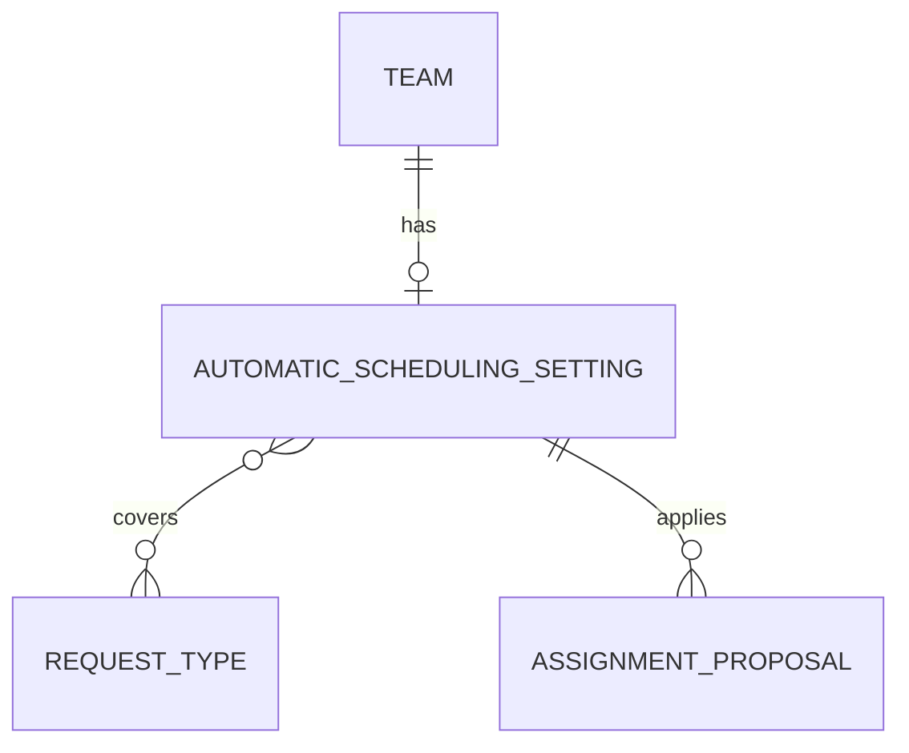
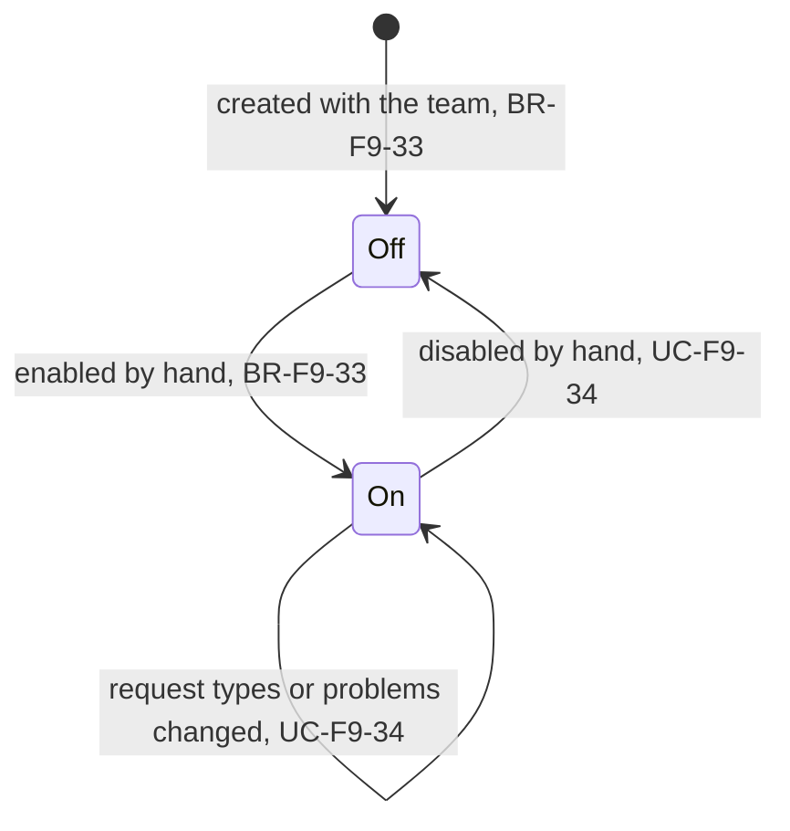

🏠 [Specs](../../../README.md) › 🧩 [Functional capabilities](../../README.md) › 👥 [F9 HR and projects](../README.md) ›
🗃️ [Data](README.md) › 🗃️ E-F9-33 Automatic scheduling setting

# 🗃️ E-F9-33 Automatic scheduling setting

**Status:** 🔄 draft (GH-2 step S4b, from VD-33 / D515)

## Purpose

Whether the scheduling engine assigns and re-plans on its own for one team, and for which request types. By default the
engine only proposes and the planner confirms. Automatic mode must be enabled by hand; in it the engine stops and
notifies the planner at the first problem (decided by the owner on 2026-11-13, VD-33).

## Fields

| Name | Type | Required | Validation | Default | Example | Personal data | Custom fields |
|---|---|---|---|---|---|---|---|
| team | team | yes | one setting per team | - | Carers Lyon east | no | - |
| request types | E-F2-25 list | yes when on | types that allow automatic mode | none | Home help visit | no | - |
| state | off, on | yes | switched by hand only | off | on | no | - |
| switched by | user | when switched | administrator or planners' manager (D517) | - | Sophie (manager) | yes | - |
| switched at | date and time | when switched | - | - | 2026-12-01 08:00 | no | - |
| stopping problems | list | yes | see below | all | all | no | - |
| cost limit | amount | no | more than 0 | none | 120 EUR per visit | no | - |
| planners notified | users | yes when on | at least one | the team's planners | Claire | yes | - |
| notice channel | in the app, email, phone | yes | - | in the app | in the app | no | - |

Problems that stop it (from the scheduling flow chart): no eligible person, a legal conflict, the window missed, over
the cost limit, an overlap. (Proposed) Each may be switched off except the legal conflict.

## Relations

- [E-F2-25 Request type](../../f02-no-code-configuration/data/e-f02-25-request-type.md): only types whose "automatic
  mode allowed" is yes.
- [E-F9-28 Assignment proposal](e-f09-28-assignment-proposal.md): applied, or stopped and handed to the planner.

## Lifecycle

At the first problem the engine stops on that work request and notifies the planner
([BR-F9-33](../business-rules/br-f09-33-automatic-mode-stops-on-a-problem.md)); the work request goes to a proposal the
planner decides. The setting stays on (D517).

## Indexes and search

By team and state; an admin list (D494).

## Retention

As the configuration versions; the switch history in the audit trail.

## Audit

Every switch on or off with who and when; every change of request types, problems, limit and notified planners.

## Import and export

None.

## Used by

- [UC-F9-34](../use-cases/12-schedule-customer-requests/uc-f09-34-run-the-automatic-scheduling.md)

## Open questions

None.

---

⬅️ [E-F9-32 Live position](e-f09-32-live-position.md) · ⬆️ [Up](README.md) ·
➡️ [E-F9-34 Attendance kiosk](e-f09-34-attendance-kiosk.md)
