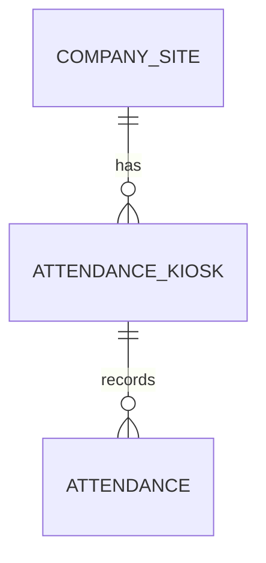
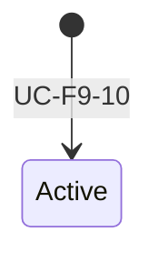

🏠 [Specs](../../../README.md) › 🧩 [Functional capabilities](../../README.md) › 👥 [F9 HR and projects](../README.md) ›
🗃️ [Data](README.md) › 🗃️ E-F9-34 Attendance kiosk

# 🗃️ E-F9-34 Attendance kiosk

**Status:** ✅ specified

## Purpose

The attendance kiosk the flow charts name with the words "kiosk" ([FL-F9-03](../flows/fl-f09-03-time.md)). The owner
decided to create it ([D516](../../../06-decisions/foundations/d516-naming-rules-and-the-seven-classes-of-names.md));
its fields are derived from the specifications and confirmed by the owner (D572).

## Fields

| Name | Type | Required | Validation | Default | Example | Personal data | Custom fields |
|---|---|---|---|---|---|---|---|
| name | text | yes | - | - | Kiosk Villeurbanne site | no | no |
| site | company site | no | - | - | Villeurbanne site | no | no |
| state | active | yes | the lifecycle below | active | active | no | no |

The name is the title the list [S-F9-L34](../screens/00-lists/s-f09-l34-attendance-kiosks.md) shows; the site is where
the kiosk stands, as the attendance screen names it ("Villeurbanne site",
[S-F9-10](../screens/03-time/s-f09-10-attendance.md)). A check-in or check-out taken at the kiosk is an attendance with
the mode kiosk ([UC-F9-10](../use-cases/03-time/uc-f09-10-record-attendance-and-overtime.md),
[E-F9-10](e-f09-10-attendance.md)); the position rule applies to the phone only
([BR-F9-06](../business-rules/br-f09-06-location-only-at-check-in.md)).

## Relations

- [E-F1-02 Company site](../../f01-administration/data/e-f01-02-company-site.md): where the kiosk stands.
- [E-F9-10 Attendance](e-f09-10-attendance.md): the check-ins and check-outs taken at it, with the mode kiosk.
- [E-F9-35 Employee badge](e-f09-35-employee-badge.md): the other way to check in that UC-F9-10 lists.

## Lifecycle

## Indexes and search

By name, site and state; searched by name, as the list [S-F9-L34](../screens/00-lists/s-f09-l34-attendance-kiosks.md)
sorts and filters it.

## Retention

As the other records of its capability.

## Audit

Every change, as the other records of its capability.

## Import and export

CSV or XLSX export of the visible rows and columns from the list
([S-F9-L34](../screens/00-lists/s-f09-l34-attendance-kiosks.md)); no import.

## Used by

- [UC-F9-10 Record attendance and overtime](../use-cases/03-time/uc-f09-10-record-attendance-and-overtime.md)

## Open questions

None.

---

⬅️ [E-F9-33 Automatic scheduling setting](e-f09-33-automatic-scheduling-setting.md) · ⬆️ [Up](README.md) ·
➡️ [E-F9-35 Employee badge](e-f09-35-employee-badge.md)
