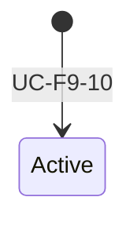

🏠 [Specs](../../../README.md) › 🧩 [Functional capabilities](../../README.md) › 👥 [F9 HR and projects](../README.md) ›
🗃️ [Data](README.md) › 🗃️ E-F9-35 Employee badge

# 🗃️ E-F9-35 Employee badge

**Status:** 🔄 waiting for the owner

## Purpose

(Proposed) The employee badge the flow charts name with the words "badge" ([FL-F9-03](../flows/fl-f09-03-time.md)). The
owner decided to create it
([D516](../../../06-decisions/foundations/d516-naming-rules-and-the-seven-classes-of-names.md)); what it holds waits for
the owner's confirmation.

## Fields

(Proposed) To define with the owner: the flow charts name the record, not its fields.

## Relations

(Proposed) To define with the owner, from the use cases below.

## Lifecycle

## Indexes and search

(Proposed) To define with the owner.

## Retention

(Proposed) As the other records of its capability, to confirm with the owner.

## Audit

(Proposed) Every change, as the other records of its capability.

## Import and export

(Proposed) To define with the owner.

## Used by

- [UC-F9-10 Record attendance and overtime](../use-cases/03-time/uc-f09-10-record-attendance-and-overtime.md)

## Open questions

(Proposed) Its fields, relations and states wait for the owner (waiting list, step 36e).

---

⬅️ [E-F9-34 Attendance kiosk](e-f09-34-attendance-kiosk.md) · ⬆️ [Up](README.md) ·
➡️ [E-F9-36 Employee referral](e-f09-36-employee-referral.md)
