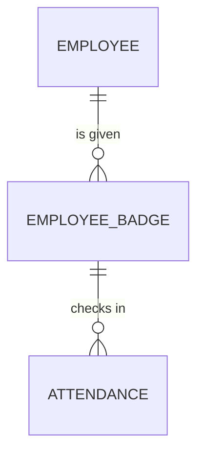
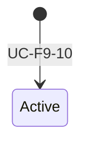

🏠 [Specs](../../../README.md) › 🧩 [Functional capabilities](../../README.md) › 👥 [F9 HR and projects](../README.md) ›
🗃️ [Data](README.md) › 🗃️ E-F9-35 Employee badge

# 🗃️ E-F9-35 Employee badge

**Status:** ✅ specified

## Purpose

The employee badge the flow charts name with the words "badge" ([FL-F9-03](../flows/fl-f09-03-time.md)). The owner
decided to create it ([D516](../../../06-decisions/foundations/d516-naming-rules-and-the-seven-classes-of-names.md));
its fields are derived from the specifications and confirmed by the owner (D572).

## Fields

| Name | Type | Required | Validation | Default | Example | Personal data | Custom fields |
|---|---|---|---|---|---|---|---|
| title | text | yes | - | - | Badge Paul Martin | yes | no |
| employee | employee record | yes | - | - | Paul Martin | yes | no |
| badge number | text | no | unique | - | B-0158 | no | no |
| assigned on | date | no | - | - | 2022-03-01 | no | no |
| state | active | yes | the lifecycle below | active | active | no | no |

The title and the employee come from the list [S-F9-L35](../screens/00-lists/s-f09-l35-employee-badges.md), whose rows
read "Badge" and the employee's name. HR assigns badges with the equipment
([UC-F9-01](../use-cases/01-people/uc-f09-01-manage-employee-records-and-contracts.md), step 4), and employees check in
with them ([UC-F9-10](../use-cases/03-time/uc-f09-10-record-attendance-and-overtime.md)); the badge number is what the
badge and RFID readers of the [integrations](../integrations.md) read.

## Relations

- [E-F9-01 Employee record](e-f09-01-employee-record.md): the holder.
- [E-F9-10 Attendance](e-f09-10-attendance.md): the check-ins and check-outs made with it, with the mode badge.
- [E-F9-34 Attendance kiosk](e-f09-34-attendance-kiosk.md): the other way to check in that UC-F9-10 lists.

## Lifecycle

## Indexes and search

By employee, badge number and state; searched by the employee's name, as the list
[S-F9-L35](../screens/00-lists/s-f09-l35-employee-badges.md) sorts and filters it.

## Retention

As the other records of its capability.

## Audit

Every change, as the other records of its capability.

## Import and export

CSV or XLSX export of the visible rows and columns from the list
([S-F9-L35](../screens/00-lists/s-f09-l35-employee-badges.md)); no import.

## Used by

- [UC-F9-10 Record attendance and overtime](../use-cases/03-time/uc-f09-10-record-attendance-and-overtime.md)

## Open questions

None.

---

⬅️ [E-F9-34 Attendance kiosk](e-f09-34-attendance-kiosk.md) · ⬆️ [Up](README.md) ·
➡️ [E-F9-36 Employee referral](e-f09-36-employee-referral.md)
