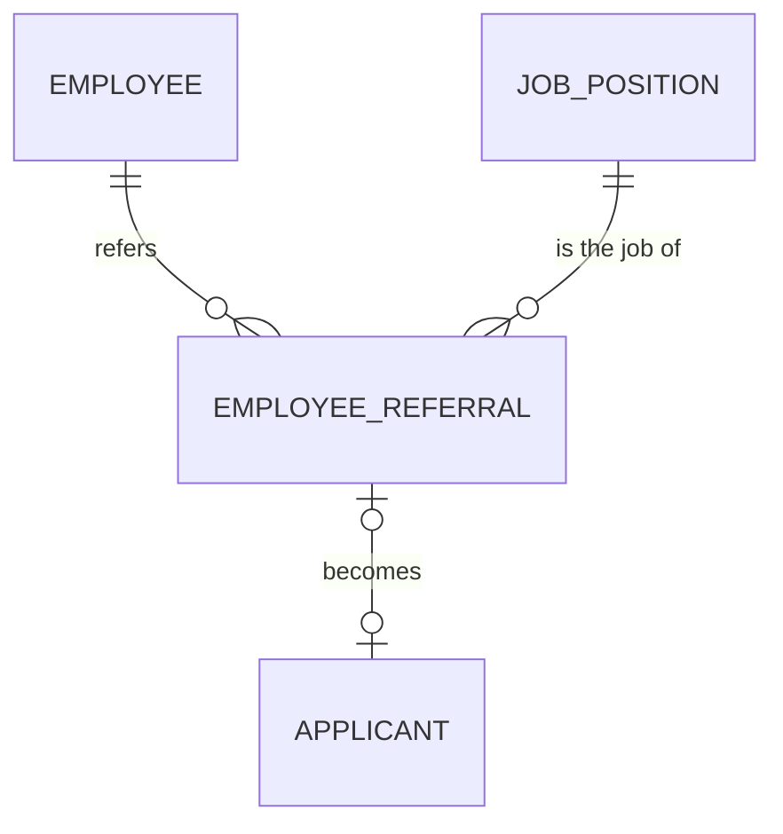
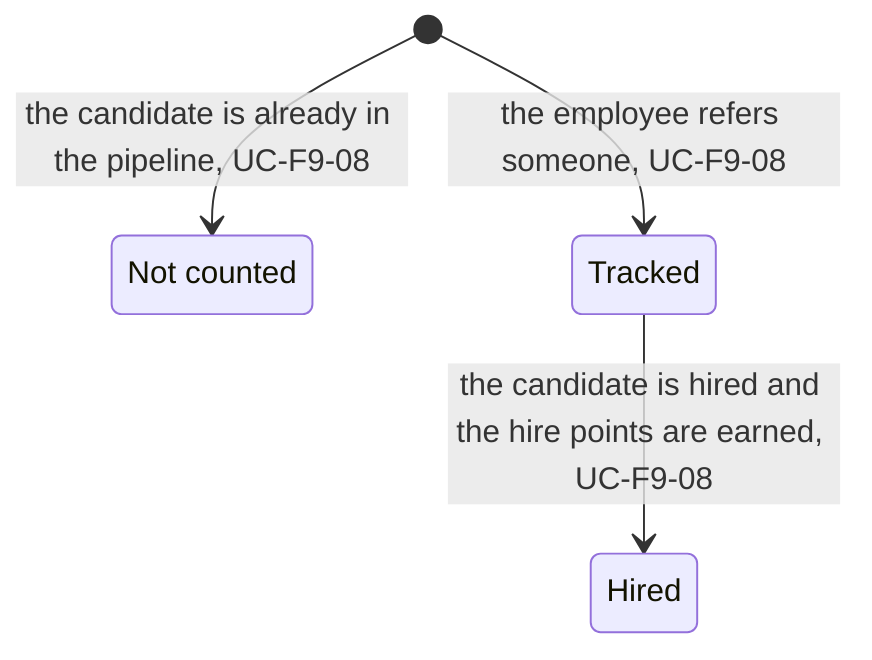

🏠 [Specs](../../../README.md) › 🧩 [Functional capabilities](../../README.md) › 👥 [F9 HR and projects](../README.md) ›
🗃️ [Data](README.md) › 🗃️ E-F9-36 Employee referral

# 🗃️ E-F9-36 Employee referral

**Status:** ✅ specified

## Purpose

The employee referral the flow charts name with the words "Referrals" ([FL-F9-02](../flows/fl-f09-02-recruit.md)). The
owner decided to create it
([D516](../../../06-decisions/foundations/d516-naming-rules-and-the-seven-classes-of-names.md)); its fields are derived
from the specifications and confirmed by the owner (D572).

## Fields

| Name | Type | Required | Validation | Default | Example | Personal data | Custom fields |
|---|---|---|---|---|---|---|---|
| title | text | yes | - | - | Electrician, by Paul Martin | yes | no |
| referrer | employee record | yes | - | - | Paul Martin | yes | no |
| job position | job position | yes | - | - | Electrician | no | no |
| candidate | name and contact | yes | - | - | Marc B. | yes | no |
| applicant | applicant | no | the referred candidate in the pipeline | - | Marc B., Driver | yes | no |
| counted | yes or no | yes | no when the candidate was already in the pipeline | - | yes | no | no |
| shared through | email, LinkedIn | no | - | - | LinkedIn | no | no |
| points | whole number | no | earned per stage the candidate reaches | - | 500 | no | no |
| state | tracked, not counted, hired | yes | the lifecycle below | tracked | hired | no | no |

From [UC-F9-08](../use-cases/02-recruit/uc-f09-08-run-referrals.md): employees share jobs and refer someone, the
referred candidates are tracked with points per stage, a candidate already in the pipeline is not counted twice, and HR
sees which referrals were hired. The title reads the job position and the referrer, as the list
[S-F9-L36](../screens/00-lists/s-f09-l36-employee-referrals.md) shows; the sharing channels are those of the screen
[S-F9-08](../screens/02-recruit/s-f09-08-referrals.md) ("Share: email, LinkedIn"). The points an employee spends on
rewards come from their balance, not from one referral.

## Relations

- [E-F9-01 Employee record](e-f09-01-employee-record.md): the referrer.
- [E-F9-06 Job position](e-f09-06-job-position.md): the job shared.
- [E-F9-07 Applicant](e-f09-07-applicant.md): the referred candidate, with the source referral.

## Lifecycle

## Indexes and search

By referrer, job position and state; HR's view of the referrals that were hired
([UC-F9-08](../use-cases/02-recruit/uc-f09-08-run-referrals.md), step 4).

## Retention

As the other records of its capability.

## Audit

Every change, as the other records of its capability.

## Import and export

CSV or XLSX export of the visible rows and columns from the list
([S-F9-L36](../screens/00-lists/s-f09-l36-employee-referrals.md)); no import.

## Used by

- [UC-F9-08 Run referrals](../use-cases/02-recruit/uc-f09-08-run-referrals.md)

## Open questions

None.

---

⬅️ [E-F9-35 Employee badge](e-f09-35-employee-badge.md) · ⬆️ [Up](README.md) ·
➡️ [E-F9-37 Field worksheet](e-f09-37-field-worksheet.md)
