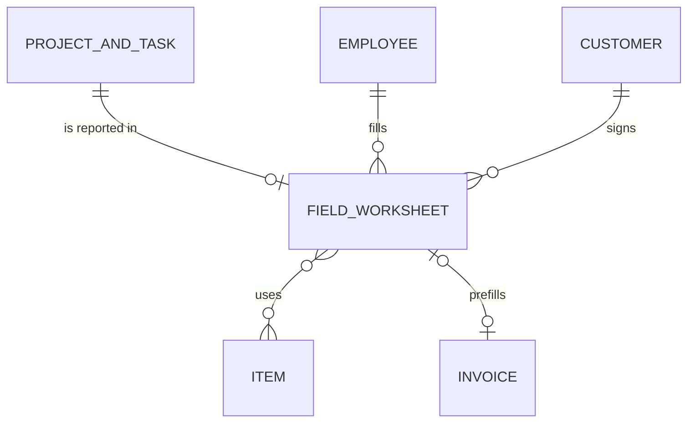
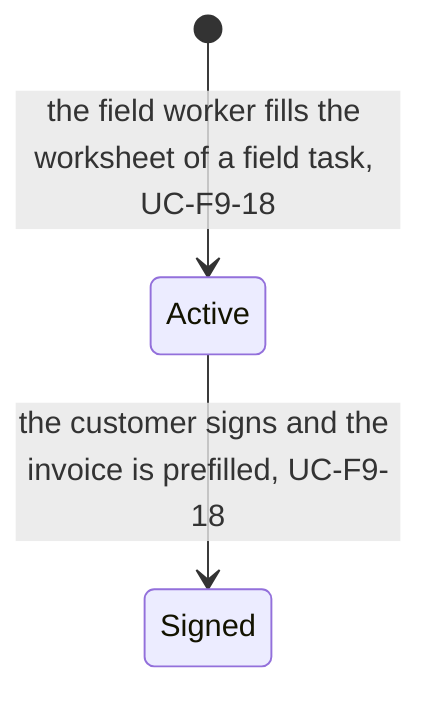

🏠 [Specs](../../../README.md) › 🧩 [Functional capabilities](../../README.md) › 👥 [F9 HR and projects](../README.md) ›
🗃️ [Data](README.md) › 🗃️ E-F9-37 Field worksheet

# 🗃️ E-F9-37 Field worksheet

**Status:** ✅ specified

## Purpose

The field worksheet the flow charts name with the words "Worksheet"
([FL-F9-06](../flows/fl-f09-06-plan-and-deliver-work.md)). The owner decided to create it
([D516](../../../06-decisions/foundations/d516-naming-rules-and-the-seven-classes-of-names.md)); its fields are derived
from the specifications and confirmed by the owner (D572).

## Fields

| Name | Type | Required | Validation | Default | Example | Personal data | Custom fields |
|---|---|---|---|---|---|---|---|
| title | text | yes | - | - | Sheet Villeurbanne 11-13 | no | no |
| task | project and task | yes | a field task | - | Visit V-212, Boiler check | no | no |
| filled by | employee record | yes | the field worker of the task | - | Karim Haddad | yes | no |
| customer | customer record | no | the task's customer | - | Durand SA | yes | no |
| date | date | no | - | - | 2026-11-13 | no | no |
| place | address | no | the task's place | - | Villeurbanne | yes | no |
| work done | list of text | no | - | - | Pressure checked, valve replaced | no | no |
| time spent | hours | no | - | - | 1.5 | no | no |
| parts | list of item and quantity | no | - | - | Valve, 1 | no | no |
| customer signature | signature | no | CR-FR-020 | - | (signed) | yes | no |
| invoice | invoice | no | prefilled when signed | - | Draft invoice | no | no |
| state | active, signed | yes | the lifecycle below | active | signed | no | no |

From [UC-F9-18](../use-cases/06-plan-and-deliver-work/uc-f09-18-run-field-service.md): the field worker fills the
worksheet of a field task on the phone, offline if needed
([D38](../../../06-decisions/ux/d38-offline-field-tasks.md)), records time and parts, gets the customer's signature
([CR-FR-020](../../../10-country-packs/france/invoicing/cr-fr-020-electronic-acceptance-and-signature.md)), and the
invoice is prefilled with the time and the parts. The work done and the signature are those the screen
[S-F9-18](../screens/06-plan-and-deliver-work/s-f09-18-field-service.md) shows ("Pressure checked", "Valve replaced",
"Customer signature"); the title reads the place and the date, as the list
[S-F9-L37](../screens/00-lists/s-f09-l37-field-worksheets.md) shows. A worksheet saved without network stays on the
phone and is sent when the network is back.

## Relations

- [E-F9-18 Project and task](e-f09-18-project-and-task.md): the field task, whose worksheet is a form with a signature.
- [E-F9-01 Employee record](e-f09-01-employee-record.md): the field worker.
- [E-F6-01 Customer record](../../f06-customers-and-sales/data/e-f06-01-customer-record.md): who signs.
- [E-F7-06 Item](../../f07-purchasing-and-stock/data/e-f07-06-item.md): the parts used.
- [E-F6-05 Invoice](../../f06-customers-and-sales/data/e-f06-05-invoice.md): prefilled from it.
- [E-SC19-04 Intervention](../../../08-sectors/sc19-trades-and-home-services/data/e-sc19-04-intervention.md) and
  [E-SC19-05 Site report](../../../08-sectors/sc19-trades-and-home-services/data/e-sc19-05-site-report.md): in the
  trades sector, the job the dispatcher follows and the part of the worksheet the invoice relies on.

## Lifecycle

## Indexes and search

By task, field worker, date and state; the worksheets of a day, as the list
[S-F9-L37](../screens/00-lists/s-f09-l37-field-worksheets.md) shows them.

## Retention

As the other records of its capability.

## Audit

Every change, as the other records of its capability.

## Import and export

CSV or XLSX export of the visible rows and columns from the list
([S-F9-L37](../screens/00-lists/s-f09-l37-field-worksheets.md)); no import.

## Used by

- [UC-F9-18 Run field service](../use-cases/06-plan-and-deliver-work/uc-f09-18-run-field-service.md)

## Open questions

None.

---

⬅️ [E-F9-36 Employee referral](e-f09-36-employee-referral.md) · ⬆️ [Up](README.md) ·
➡️ [E-F9-38 Job offer](e-f09-38-job-offer.md)
