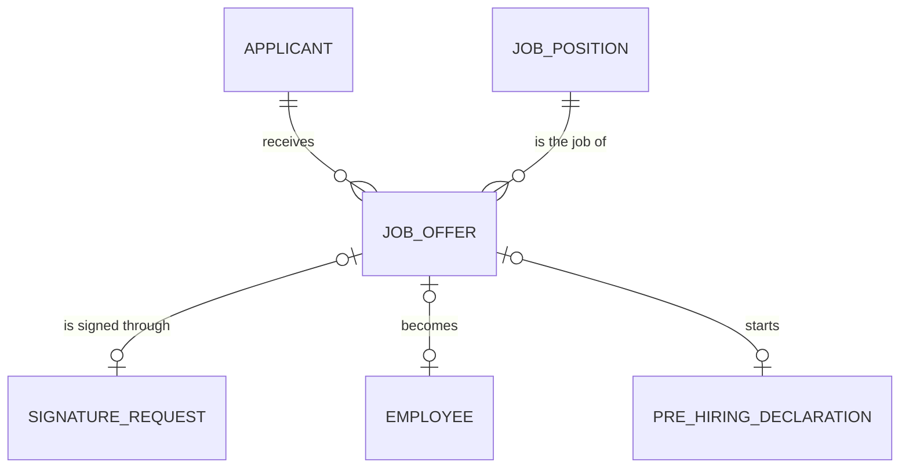
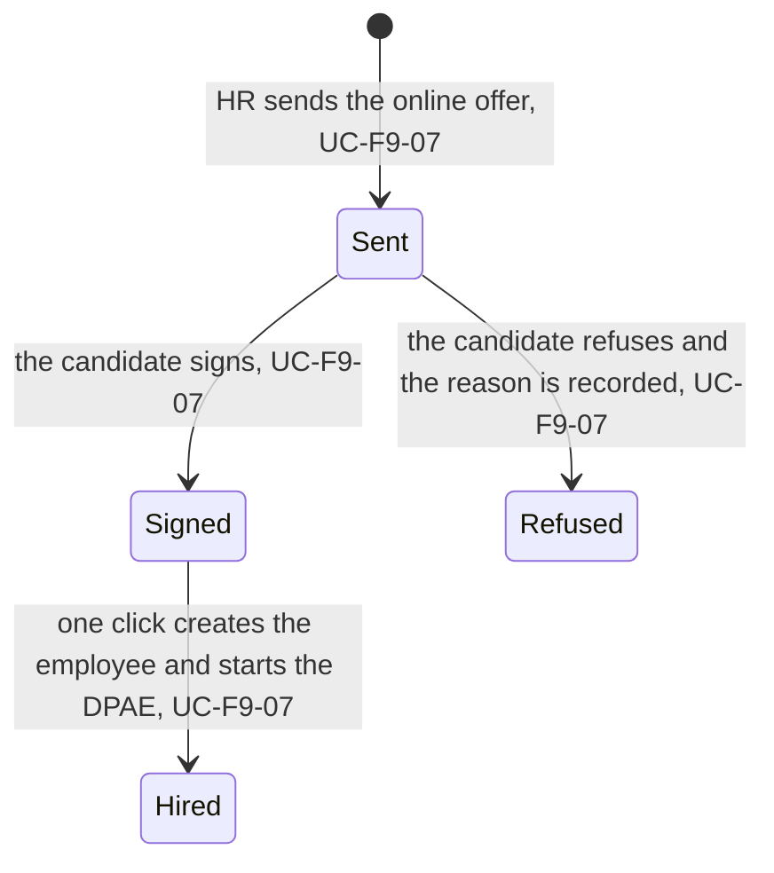

🏠 [Specs](../../../README.md) › 🧩 [Functional capabilities](../../README.md) › 👥 [F9 HR and projects](../README.md) ›
🗃️ [Data](README.md) › 🗃️ E-F9-38 Job offer

# 🗃️ E-F9-38 Job offer

**Status:** ✅ specified

## Purpose

The job offer the flow charts name with the words "Online offer" ([FL-F9-02](../flows/fl-f09-02-recruit.md)). The owner
decided to create it ([D516](../../../06-decisions/foundations/d516-naming-rules-and-the-seven-classes-of-names.md));
its fields are derived from the specifications and confirmed by the owner (D572).

## Fields

| Name | Type | Required | Validation | Default | Example | Personal data | Custom fields |
|---|---|---|---|---|---|---|---|
| title | text | yes | - | - | Site manager, Lyon | no | no |
| applicant | applicant | yes | - | - | Karim B. | yes | no |
| job position | job position | no | - | - | Site manager | no | no |
| gross salary | money per period | no | - | - | 46,000 EUR per year | yes | no |
| package | list of choices | no | within the limits HR sets | - | (the candidate's choices) | yes | no |
| start | date | no | - | - | 2026-12-01 | no | no |
| sent on, signed on | dates | when sent, when signed | - | - | 2026-11-10, 2026-11-12 | no | no |
| signature | signature request | when signed | - | - | (signed) | yes | no |
| refusal reason | text | when refused | - | - | Salary | no | no |
| employee | employee record | when hired | created in one click from the signed offer | - | Karim B. | yes | no |
| state | sent, signed, refused, hired | yes | the lifecycle below | sent | signed | no | no |

From [UC-F9-07](../use-cases/02-recruit/uc-f09-07-make-an-offer-and-hire.md): HR sends an online offer, the candidate
builds the package within limits and signs it
([UC-F2-14](../../f02-no-code-configuration/use-cases/07-benchmark-additions/uc-f02-14-send-documents-for-e-signature.md)),
a refused offer keeps its reason, and one click makes the employee and starts the DPAE and the onboarding. The salary,
the start and the dates are those the screen [S-F9-07](../screens/02-recruit/s-f09-07-offer.md) shows ("Sent 10 Nov,
signed 12 Nov", "46,000 EUR per year", "1 Dec 2026"); the title is the one the list
[S-F9-L38](../screens/00-lists/s-f09-l38-job-offers.md) shows.

## Relations

- [E-F9-07 Applicant](e-f09-07-applicant.md): the candidate.
- [E-F9-06 Job position](e-f09-06-job-position.md): the job offered.
- [E-F2-14 Signature request](../../f02-no-code-configuration/data/e-f02-14-signature-request.md): the candidate's
  signature.
- [E-F9-01 Employee record](e-f09-01-employee-record.md) and [E-F9-02 Contract](e-f09-02-contract.md): what the hire
  creates.
- [E-F9-41 Pre-hiring declaration (DPAE)](e-f09-41-pre-hiring-declaration-dpae.md): started by the hire; the start stays
  blocked until it is acknowledged ([BR-F9-03](../business-rules/br-f09-03-dpae-before-the-first-day.md)).

## Lifecycle

## Indexes and search

By applicant, job position and state; the time to hire runs from the position's opening to the signed offer
([reports](../reports.md)).

## Retention

As the other records of its capability.

## Audit

Every change, as the other records of its capability.

## Import and export

CSV or XLSX export of the visible rows and columns from the list
([S-F9-L38](../screens/00-lists/s-f09-l38-job-offers.md)); no import.

## Used by

- [UC-F9-07 Make an offer and hire](../use-cases/02-recruit/uc-f09-07-make-an-offer-and-hire.md)

## Open questions

None.

---

⬅️ [E-F9-37 Field worksheet](e-f09-37-field-worksheet.md) · ⬆️ [Up](README.md) ·
➡️ [E-F9-39 Lunch order](e-f09-39-lunch-order.md)
