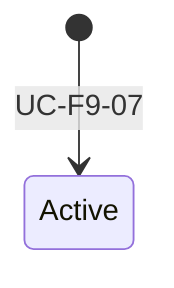

🏠 [Specs](../../../README.md) › 🧩 [Functional capabilities](../../README.md) › 👥 [F9 HR and projects](../README.md) ›
🗃️ [Data](README.md) › 🗃️ E-F9-38 Job offer

# 🗃️ E-F9-38 Job offer

**Status:** 🔄 waiting for the owner

## Purpose

(Proposed) The job offer the flow charts name with the words "Online offer" ([FL-F9-02](../flows/fl-f09-02-recruit.md)).
The owner decided to create it
([D516](../../../06-decisions/foundations/d516-naming-rules-and-the-seven-classes-of-names.md)); what it holds waits for
the owner's confirmation.

## Fields

(Proposed) To define with the owner: the flow charts name the record, not its fields.

## Relations

(Proposed) To define with the owner, from the use cases below.

## Lifecycle

## Indexes and search

(Proposed) To define with the owner.

## Retention

(Proposed) As the other records of its capability, to confirm with the owner.

## Audit

(Proposed) Every change, as the other records of its capability.

## Import and export

(Proposed) To define with the owner.

## Used by

- [UC-F9-07 Make an offer and hire](../use-cases/02-recruit/uc-f09-07-make-an-offer-and-hire.md)

## Open questions

(Proposed) Its fields, relations and states wait for the owner (waiting list, step 36e).

---

⬅️ [E-F9-37 Field worksheet](e-f09-37-field-worksheet.md) · ⬆️ [Up](README.md) ·
➡️ [E-F9-39 Lunch order](e-f09-39-lunch-order.md)
