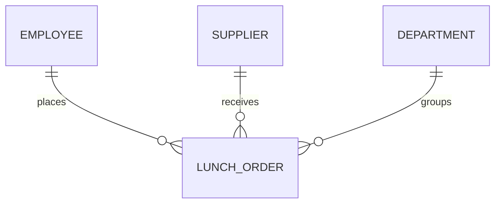
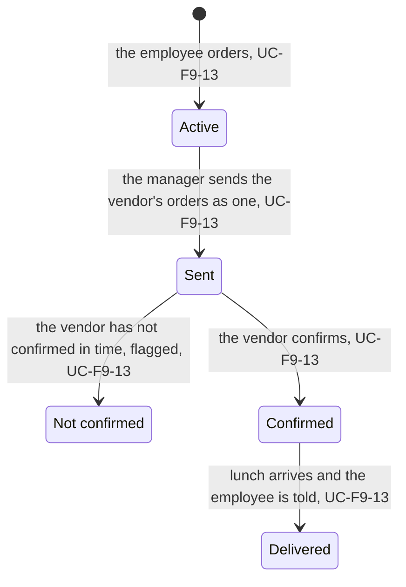

🏠 [Specs](../../../README.md) › 🧩 [Functional capabilities](../../README.md) › 👥 [F9 HR and projects](../README.md) ›
🗃️ [Data](README.md) › 🗃️ E-F9-39 Lunch order

# 🗃️ E-F9-39 Lunch order

**Status:** ✅ specified

## Purpose

The lunch order the flow charts name with the words "Lunch orders"
([FL-F9-05](../flows/fl-f09-05-workplace-services.md)). The owner decided to create it
([D516](../../../06-decisions/foundations/d516-naming-rules-and-the-seven-classes-of-names.md)); its fields are derived
from the specifications and confirmed by the owner (D572).

## Fields

| Name | Type | Required | Validation | Default | Example | Personal data | Custom fields |
|---|---|---|---|---|---|---|---|
| title | text | yes | - | - | Lunch 11-13, Paul Martin | yes | no |
| employee | employee record | yes | - | - | Paul Martin | yes | no |
| date | date | yes | - | - | 2026-11-13 | no | no |
| team | department | no | - | - | Works team | no | no |
| vendor | supplier record | yes | - | - | Le Bistrot | no | no |
| dish | text | yes | - | - | Salad | no | no |
| price | money | no | - | - | 11.50 EUR | no | no |
| sent by, sent at | manager, date and time | when sent | - | - | Marc Durand, 2026-11-13 10:30 | yes | no |
| confirm by | time | no | - | - | 11:00 | no | no |
| state | active, sent, confirmed, not confirmed, delivered | yes | the lifecycle below | active | sent | no | no |

From [UC-F9-13](../use-cases/05-workplace-services/uc-f09-13-request-approvals-and-order-lunch.md): employees order
from vendors, the manager sends the orders and the vendor gets one order for them, an order the vendor has not
confirmed by its time is flagged, and employees are told when lunch arrives. The dish and the price are those the
screen [S-F9-13](../screens/05-workplace-services/s-f09-13-approvals-and-lunch.md) shows ("Le Bistrot", "Salad",
"11.50 EUR"); the team is the one the example rows of the list [S-F9-L39](../screens/00-lists/s-f09-l39-lunch-orders.md)
name.

## Relations

- [E-F9-01 Employee record](e-f09-01-employee-record.md): who orders, and the manager who sends.
- [E-F7-01 Supplier record](../../f07-purchasing-and-stock/data/e-f07-01-supplier-record.md): the vendor.
- [E-F9-03 Department](e-f09-03-department.md): the team.

## Lifecycle

## Indexes and search

By date, vendor, team, employee and state; the day's orders of a vendor, which the manager sends as one.

## Retention

As the other records of its capability.

## Audit

Every change, as the other records of its capability.

## Import and export

CSV or XLSX export of the visible rows and columns from the list
([S-F9-L39](../screens/00-lists/s-f09-l39-lunch-orders.md)); no import.

## Used by

- [UC-F9-13 Request approvals and order lunch](../use-cases/05-workplace-services/uc-f09-13-request-approvals-and-order-lunch.md)

## Open questions

None. One lunch order per employee, as
[UC-F9-13](../use-cases/05-workplace-services/uc-f09-13-request-approvals-and-order-lunch.md) says (the use case beats
the list's example rows, [D573](../../../06-decisions/foundations/d573-precedence-between-spec-pages.md)); the list
[S-F9-L39](../screens/00-lists/s-f09-l39-lunch-orders.md) shows one row per employee's order, grouped by day and team.

---

⬅️ [E-F9-38 Job offer](e-f09-38-job-offer.md) · ⬆️ [Up](README.md) ·
➡️ [E-F9-40 Personnel register](e-f09-40-personnel-register.md)
