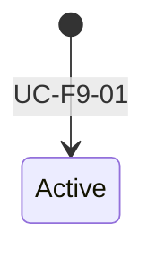

🏠 [Specs](../../../README.md) › 🧩 [Functional capabilities](../../README.md) › 👥 [F9 HR and projects](../README.md) ›
🗃️ [Data](README.md) › 🗃️ E-F9-40 Personnel register

# 🗃️ E-F9-40 Personnel register

**Status:** 🔄 waiting for the owner

## Purpose

(Proposed) The personnel register the flow charts name with the words "Personnel register"
([FL-F9-01](../flows/fl-f09-01-people.md)). The owner decided to create it
([D516](../../../06-decisions/foundations/d516-naming-rules-and-the-seven-classes-of-names.md)); what it holds waits for
the owner's confirmation.

## Fields

(Proposed) To define with the owner: the flow charts name the record, not its fields.

## Relations

(Proposed) To define with the owner, from the use cases below.

## Lifecycle

## Indexes and search

(Proposed) To define with the owner.

## Retention

(Proposed) As the other records of its capability, to confirm with the owner.

## Audit

(Proposed) Every change, as the other records of its capability.

## Import and export

(Proposed) To define with the owner.

## Used by

- [UC-F9-01 Manage employee records and contracts](../use-cases/01-people/uc-f09-01-manage-employee-records-and-contracts.md)

## Open questions

(Proposed) Its fields, relations and states wait for the owner (waiting list, step 36e).

---

⬅️ [E-F9-39 Lunch order](e-f09-39-lunch-order.md) · ⬆️ [Up](README.md) ·
➡️ [E-F9-41 Pre-hiring declaration (DPAE)](e-f09-41-pre-hiring-declaration-dpae.md)
