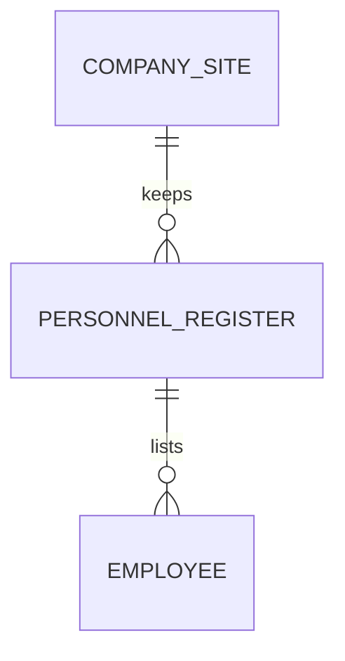
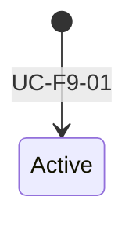

🏠 [Specs](../../../README.md) › 🧩 [Functional capabilities](../../README.md) › 👥 [F9 HR and projects](../README.md) ›
🗃️ [Data](README.md) › 🗃️ E-F9-40 Personnel register

# 🗃️ E-F9-40 Personnel register

**Status:** ✅ specified

## Purpose

The personnel register the flow charts name with the words "Personnel register"
([FL-F9-01](../flows/fl-f09-01-people.md)). The owner decided to create it
([D516](../../../06-decisions/foundations/d516-naming-rules-and-the-seven-classes-of-names.md)); its fields are derived
from the specifications and confirmed by the owner (D572).

## Fields

| Name | Type | Required | Validation | Default | Example | Personal data | Custom fields |
|---|---|---|---|---|---|---|---|
| title | text | yes | - | - | Personnel register Lyon | no | no |
| establishment | company site | yes | one register per establishment (CR-FR-038) | - | Lyon | no | no |
| entries | list of employee, entry date, exit date | no | in hiring order; an entry on the first day; the exit date on departure; never deleted (BR-F9-03, CR-FR-038) | - | Léa Moreau, 2026-12-01 | yes | no |
| state | active | yes | the lifecycle below | active | active | no | no |

From [UC-F9-03](../use-cases/01-people/uc-f09-03-comply-with-french-hr-duties.md): the register updates on arrivals and
departures, and shows the exit date of a departure. Each establishment keeps its register, and what an entry must
mention is in the country pack's rule
([CR-FR-038](../../../10-country-packs/france/labour/cr-fr-038-personnel-register.md),
[BR-F9-03](../business-rules/br-f09-03-dpae-before-the-first-day.md)). The title reads the site: one register per
establishment, kept continuously in hiring order and never split by year (settled by
[D573](../../../06-decisions/foundations/d573-precedence-between-spec-pages.md): the law beats a screen).

## Relations

- [E-F1-02 Company site](../../f01-administration/data/e-f01-02-company-site.md): the establishment.
- [E-F9-01 Employee record](e-f09-01-employee-record.md): each entry's employee.
- [E-F9-41 Pre-hiring declaration (DPAE)](e-f09-41-pre-hiring-declaration-dpae.md): acknowledged before the entry's
  first day.
- [E-F9-05 HR duty](e-f09-05-hr-duty.md): the register entry as a duty with its due date.

## Lifecycle

## Indexes and search

By establishment; an entry found by employee, entry date or exit date, or filtered by year of entry.

## Retention

The register lasts as long as its establishment; each entry is kept 5 years after the employee leaves
([CR-FR-038](../../../10-country-packs/france/labour/cr-fr-038-personnel-register.md),
[CR-FR-047](../../../10-country-packs/france/labour/cr-fr-047-hr-records-retention.md)); entries are never deleted
before.

## Audit

Every change, as the other records of its capability.

## Import and export

The register as a document ([reports](../reports.md)); CSV or XLSX export of the visible rows and columns from the list
([S-F9-L40](../screens/00-lists/s-f09-l40-personnel-registers.md)); no import, and entries are never deleted.

## Used by

- [UC-F9-01 Manage employee records and contracts](../use-cases/01-people/uc-f09-01-manage-employee-records-and-contracts.md)

## Open questions

None. One register per establishment
([CR-FR-038](../../../10-country-packs/france/labour/cr-fr-038-personnel-register.md)); the list
[S-F9-L40](../screens/00-lists/s-f09-l40-personnel-registers.md) shows one row per site, without a year.

---

⬅️ [E-F9-39 Lunch order](e-f09-39-lunch-order.md) · ⬆️ [Up](README.md) ·
➡️ [E-F9-41 Pre-hiring declaration (DPAE)](e-f09-41-pre-hiring-declaration-dpae.md)
