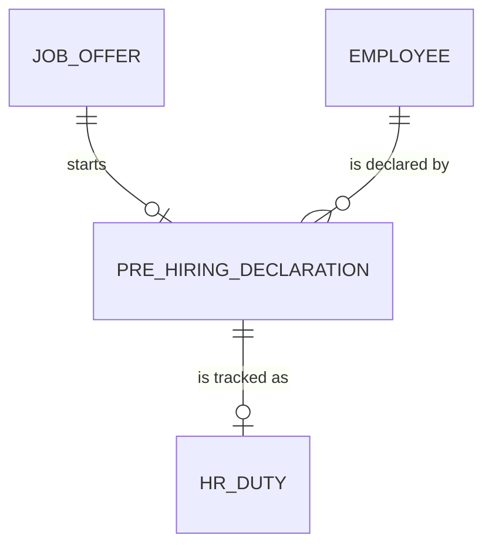
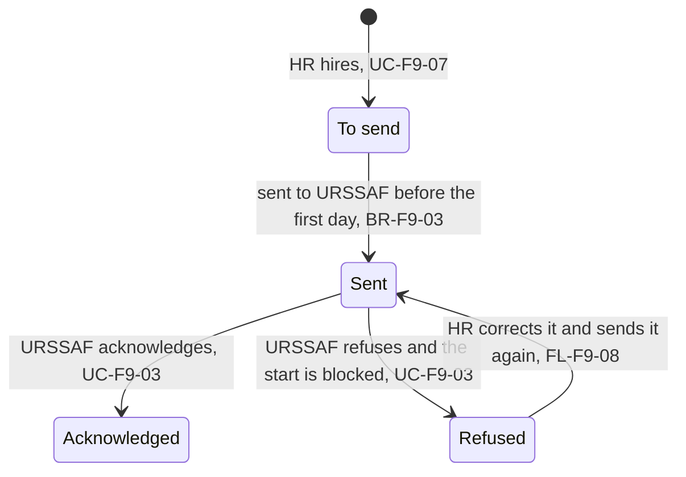

🏠 [Specs](../../../README.md) › 🧩 [Functional capabilities](../../README.md) › 👥 [F9 HR and projects](../README.md) ›
🗃️ [Data](README.md) › 🗃️ E-F9-41 Pre-hiring declaration (DPAE)

# 🗃️ E-F9-41 Pre-hiring declaration (DPAE)

**Status:** ✅ specified

## Purpose

The pre-hiring declaration (dpae) the flow charts name with the words "DPAE" ([FL-F9-01](../flows/fl-f09-01-people.md)).
The owner decided to create it
([D516](../../../06-decisions/foundations/d516-naming-rules-and-the-seven-classes-of-names.md)); its fields are derived
from the specifications and confirmed by the owner (D572).

## Fields

| Name | Type | Required | Validation | Default | Example | Personal data | Custom fields |
|---|---|---|---|---|---|---|---|
| title | text | yes | - | - | DPAE Karim B. | yes | no |
| employee | employee record | yes | - | - | Karim B. | yes | no |
| job offer | job offer | no | - | - | Site manager, Lyon | no | no |
| start | date | yes | sent and acknowledged before the start (BR-F9-03, CR-FR-037) | - | 2026-12-01 | no | no |
| declared data | the hire's identity and contract | yes | read from the employee record and the contract when sent | - | (identity, contract) | yes | no |
| sent at | date and time | when sent | - | - | 2026-11-24 09:00 | no | no |
| acknowledged at | date and time | when acknowledged | URSSAF's acknowledgement | - | 2026-11-24 09:02 | no | no |
| refusal reason | text | when refused | URSSAF's reason, shown to HR | - | Wrong NIR | no | no |
| state | to send, sent, acknowledged, refused | yes | the lifecycle below | to send | acknowledged | no | no |

From [UC-F9-03](../use-cases/01-people/uc-f09-03-comply-with-french-hr-duties.md) and
[BR-F9-03](../business-rules/br-f09-03-dpae-before-the-first-day.md): the hire starts the DPAE
([UC-F9-07](../use-cases/02-recruit/uc-f09-07-make-an-offer-and-hire.md)), it goes to URSSAF through its API before the
first day within the window of
[CR-FR-037](../../../10-country-packs/france/labour/cr-fr-037-dpae-before-the-first-day.md), and a refusal shows its
reason and blocks the start. The state "Acknowledged" is the one the screen
[S-F9-03](../screens/01-people/s-f09-03-hr-duties.md) shows; the title is the one the list
[S-F9-L41](../screens/00-lists/s-f09-l41-pre-hiring-declaration-dpae-s.md) shows.

## Relations

- [E-F9-38 Job offer](e-f09-38-job-offer.md): the signed offer whose hire starts it.
- [E-F9-01 Employee record](e-f09-01-employee-record.md) and [E-F9-02 Contract](e-f09-02-contract.md): where the
  declared data comes from.
- [E-F9-05 HR duty](e-f09-05-hr-duty.md): the duty of kind DPAE, with its due date.
- [E-F9-40 Personnel register](e-f09-40-personnel-register.md): the entry made on the first day.

## Lifecycle

HR is told at once when a DPAE is acknowledged or refused ([notifications](../notifications.md)); the correction is the
"Correct it" of the refused case of [FL-F9-08](../flows/fl-f09-08-hr-duties.md).

## Indexes and search

By employee, start and state; the refused ones and the ones still to send before a start.

## Retention

As the other records of its capability.

## Audit

Every change, as the other records of its capability.

## Import and export

Sent to URSSAF through its API ([integrations](../integrations.md)); CSV or XLSX export of the visible rows and columns
from the list ([S-F9-L41](../screens/00-lists/s-f09-l41-pre-hiring-declaration-dpae-s.md)); no import.

## Used by

- [UC-F9-03 Comply with French HR duties](../use-cases/01-people/uc-f09-03-comply-with-french-hr-duties.md)

## Open questions

None.

---

⬅️ [E-F9-40 Personnel register](e-f09-40-personnel-register.md) · ⬆️ [Up](README.md) ·
➡️ [E-F9-42 Reception kiosk](e-f09-42-reception-kiosk.md)
