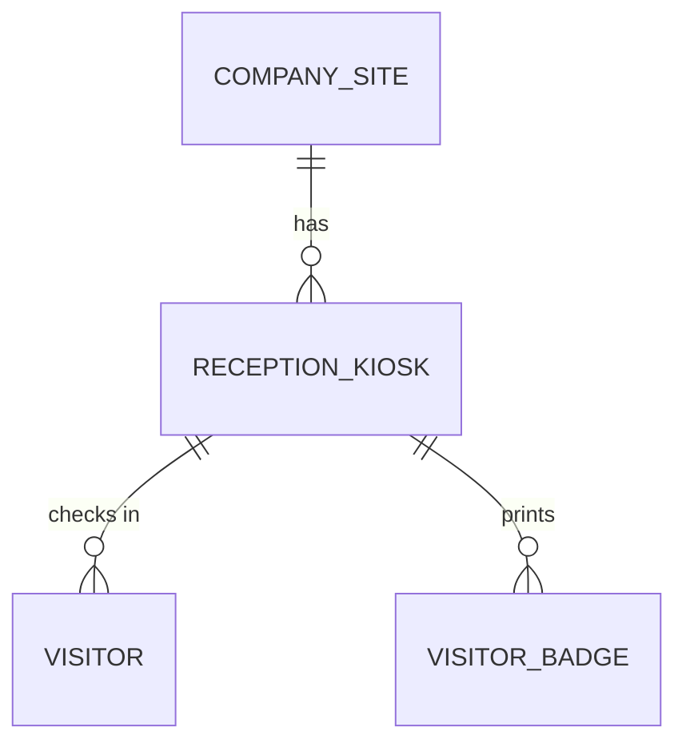
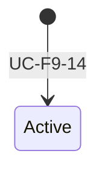

🏠 [Specs](../../../README.md) › 🧩 [Functional capabilities](../../README.md) › 👥 [F9 HR and projects](../README.md) ›
🗃️ [Data](README.md) › 🗃️ E-F9-42 Reception kiosk

# 🗃️ E-F9-42 Reception kiosk

**Status:** ✅ specified

## Purpose

The reception kiosk the flow charts name with the words "kiosk" ([FL-F9-05](../flows/fl-f09-05-workplace-services.md)).
The owner decided to create it
([D516](../../../06-decisions/foundations/d516-naming-rules-and-the-seven-classes-of-names.md)); its fields are derived
from the specifications and confirmed by the owner (D572).

## Fields

| Name | Type | Required | Validation | Default | Example | Personal data | Custom fields |
|---|---|---|---|---|---|---|---|
| name | text | yes | - | - | Reception Lyon head office | no | no |
| site | company site | no | - | - | Lyon head office | no | no |
| reception | users | no | told when no host is found | - | Nadia R. | yes | no |
| state | active | yes | the lifecycle below | active | active | no | no |

The name is the title the list [S-F9-L42](../screens/00-lists/s-f09-l42-reception-kiosks.md) shows, and the screen
[S-F9-14](../screens/05-workplace-services/s-f09-14-visitors.md) names the reception it serves ("Lyon reception").
Visitors check in at the kiosk, the host is notified and a badge is printed; when no host is found, reception is
notified ([UC-F9-14](../use-cases/05-workplace-services/uc-f09-14-welcome-visitors.md)).

## Relations

- [E-F1-02 Company site](../../f01-administration/data/e-f01-02-company-site.md): where the kiosk stands.
- [E-F9-15 Visitor](e-f09-15-visitor.md): the visitors who check in at it.
- [E-F9-43 Visitor badge](e-f09-43-visitor-badge.md): the badges it prints.

## Lifecycle

## Indexes and search

By name, site and state; searched by name, as the list [S-F9-L42](../screens/00-lists/s-f09-l42-reception-kiosks.md)
sorts and filters it.

## Retention

As the other records of its capability.

## Audit

Every change, as the other records of its capability.

## Import and export

CSV or XLSX export of the visible rows and columns from the list
([S-F9-L42](../screens/00-lists/s-f09-l42-reception-kiosks.md)); no import.

## Used by

- [UC-F9-14 Welcome visitors](../use-cases/05-workplace-services/uc-f09-14-welcome-visitors.md)

## Open questions

None.

---

⬅️ [E-F9-41 Pre-hiring declaration (DPAE)](e-f09-41-pre-hiring-declaration-dpae.md) · ⬆️ [Up](README.md) ·
➡️ [E-F9-43 Visitor badge](e-f09-43-visitor-badge.md)
