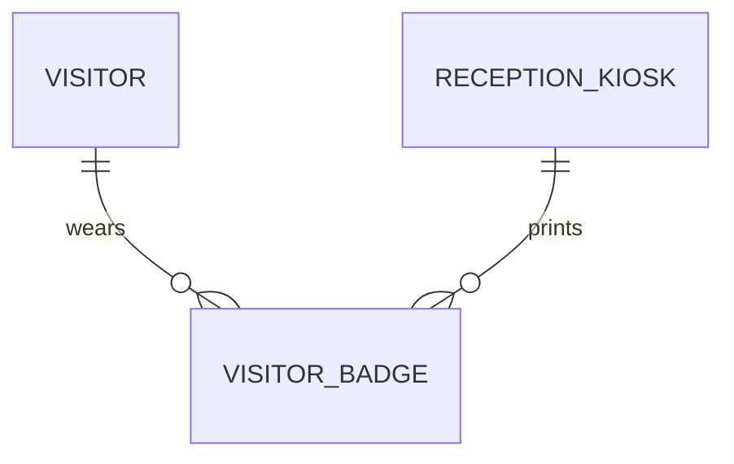
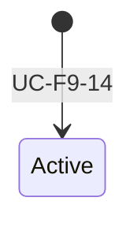

🏠 [Specs](../../../README.md) › 🧩 [Functional capabilities](../../README.md) › 👥 [F9 HR and projects](../README.md) ›
🗃️ [Data](README.md) › 🗃️ E-F9-43 Visitor badge

# 🗃️ E-F9-43 Visitor badge

**Status:** ✅ specified

## Purpose

The visitor badge the flow charts name with the words "badge" ([FL-F9-05](../flows/fl-f09-05-workplace-services.md)).
The owner decided to create it
([D516](../../../06-decisions/foundations/d516-naming-rules-and-the-seven-classes-of-names.md)); its fields are derived
from the specifications and confirmed by the owner (D572).

## Fields

| Name | Type | Required | Validation | Default | Example | Personal data | Custom fields |
|---|---|---|---|---|---|---|---|
| title | text | yes | - | - | Visitor badge V-0412 | no | no |
| number | text | no | unique | - | V-0412 | no | no |
| visitor | visitor | yes | - | - | J. Durand, Durand SA | yes | no |
| printed at | reception kiosk | no | - | - | Reception Lyon head office | no | no |
| printed on | date and time | no | at the visitor's check-in | - | 2026-11-13 10:02 | no | no |
| state | active | yes | the lifecycle below | active | active | no | no |

The title and the number come from the list [S-F9-L43](../screens/00-lists/s-f09-l43-visitor-badges.md). A badge is
printed for the visitor when they check in and the host is notified
([UC-F9-14](../use-cases/05-workplace-services/uc-f09-14-welcome-visitors.md)); visitor data is kept briefly
([CR-FR-052](../../../10-country-packs/france/data-protection/cr-fr-052-storage-limitation.md)).

## Relations

- [E-F9-15 Visitor](e-f09-15-visitor.md): who wears it.
- [E-F9-42 Reception kiosk](e-f09-42-reception-kiosk.md): where it was printed.

## Lifecycle

## Indexes and search

By number, visitor and state; searched by number, as the list
[S-F9-L43](../screens/00-lists/s-f09-l43-visitor-badges.md) sorts and filters it.

## Retention

As the other records of its capability.

## Audit

Every change, as the other records of its capability.

## Import and export

CSV or XLSX export of the visible rows and columns from the list
([S-F9-L43](../screens/00-lists/s-f09-l43-visitor-badges.md)); no import.

## Used by

- [UC-F9-14 Welcome visitors](../use-cases/05-workplace-services/uc-f09-14-welcome-visitors.md)

## Open questions

None.

---

⬅️ [E-F9-42 Reception kiosk](e-f09-42-reception-kiosk.md) · ⬆️ [Up](README.md) ·
➡️ [E-F9-44 Sourcing search](e-f09-44-sourcing-search.md)
