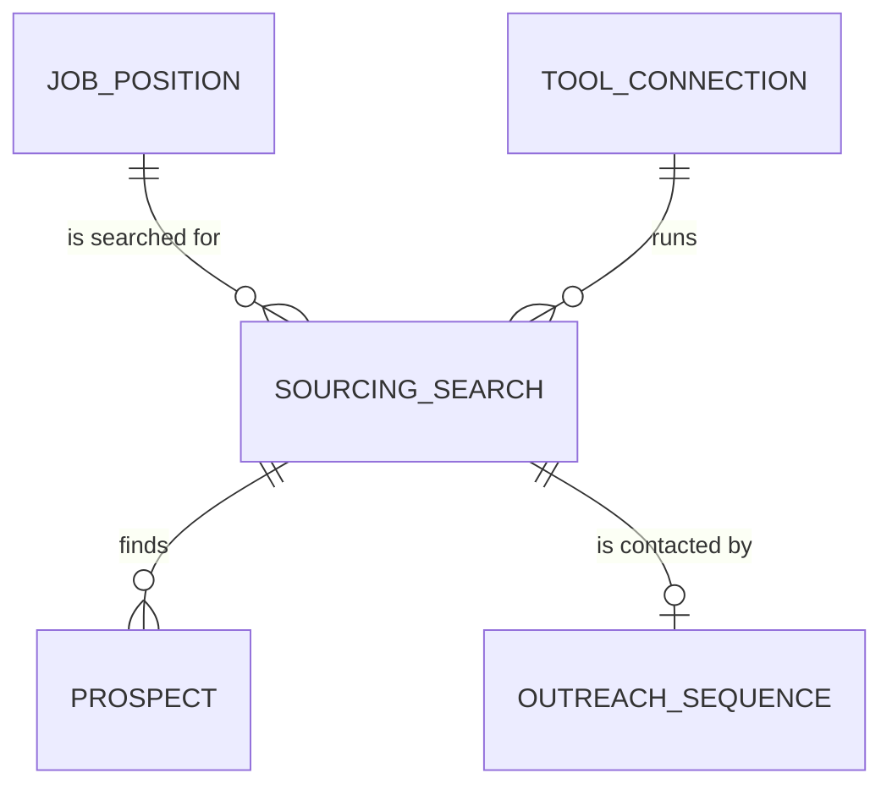
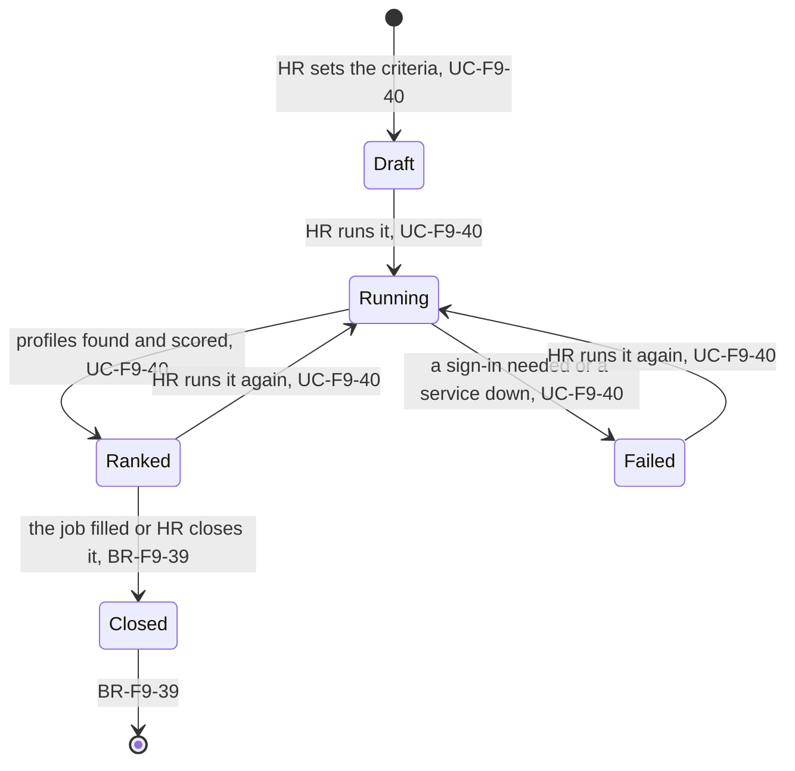

🏠 [Specs](../../../README.md) › 🧩 [Functional capabilities](../../README.md) › 👥 [F9 HR and projects](../README.md) ›
🗃️ [Data](README.md) › 🗃️ E-F9-44 Sourcing search

# 🗃️ E-F9-44 Sourcing search

**Status:** ✅ specified

## Purpose

A saved LinkedIn search for a job position: its criteria, the LinkedIn account it runs on through Unipile, and its runs
([D518](../../../06-decisions/f09-hr-and-projects/d518-linkedin-sourcing-through-unipile.md)).

## Fields

| Name | Type | Required | Validation | Default | Example | Personal data | Custom fields |
|---|---|---|---|---|---|---|---|
| job position | job position | yes | - | - | Site manager | no | no |
| LinkedIn account | tool connection (E-F24-02) | yes | an active Unipile link of the HR user | - | Claire P. on LinkedIn | yes | no |
| titles | list of text | no | - | from the job position | site manager, works supervisor | no | no |
| skills | list | no | - | from the job position | site planning, site safety | no | no |
| seniority | list | no | - | - | senior | no | no |
| years of experience | range | no | 0 to 50 | - | 5 to 15 | no | no |
| location and radius | place and km | no | - | the job's site | Lyon, 40 km | no | no |
| languages | list with levels | no | - | - | French, English B2 | no | no |
| industries | list | no | - | - | construction | no | no |
| employers to include, to exclude | lists | no | - | the company itself excluded | exclude Acme Bâtiment | no | no |
| education | list | no | - | - | civil engineering | no | no |
| keywords | text with AND, OR, NOT and quotes | no | balanced quotes and brackets | - | "gros oeuvre" AND NOT intern | no | no |
| open to work | yes or no | no | - | no | yes | no | no |
| criteria applied by the AI assistant | list | no | those the account's search lacks, as Unipile reports it (D571) | - | years of experience | no | no |
| state | draft, running, ranked, failed, closed | yes | the lifecycle below | draft | ranked | no | no |
| runs | list of date, profiles found, limit reached | no | - | - | 2026-11-03, 48, no | no | no |
| owner | user | yes | HR | the creator | Claire P. | yes | no |

Every criterion is checked by
[BR-F9-40 No search criterion the law forbids in hiring](../business-rules/br-f09-40-no-criterion-the-law-forbids-in-hiring.md)
before a run.

## Relations

- [E-F9-06 Job position](e-f09-06-job-position.md)
- [E-F24-02 Tool connection](../../f24-integrations-hub/data/e-f24-02-tool-connection.md)
- [E-F9-45 Prospect](e-f09-45-prospect.md)
- [E-F9-46 Outreach sequence](e-f09-46-outreach-sequence.md)

## Lifecycle

## Indexes and search

By job position, owner, state and date of the last run.

## Retention

The criteria are kept while the job position is open and 2 years after, as the applicants' term
([BR-F9-11](../business-rules/br-f09-11-candidate-data-has-a-term.md)); the profiles never shortlisted are dropped when
the search closes ([BR-F9-39](../business-rules/br-f09-39-prospects-kept-only-as-long-as-needed.md)).

## Audit

Every change of the criteria and every run, with who, when, the old and the new value.

## Import and export

No import. The criteria are exported with the job position.

## Used by

- [UC-F9-40 Search and rank LinkedIn profiles](../use-cases/02-recruit/uc-f09-40-search-and-rank-linkedin-profiles.md)
- [UC-F9-41 Run a LinkedIn outreach sequence](../use-cases/02-recruit/uc-f09-41-run-a-linkedin-outreach-sequence.md)

## Open questions

- [Q19 Which LinkedIn search sourcing uses](../../../07-questions/q19-which-linkedin-search-sourcing-uses.md),
  answered by
  [D571 LinkedIn sourcing uses the user's search](../../../06-decisions/f09-hr-and-projects/d571-linkedin-sourcing-uses-the-users-search.md)

---

⬅️ [E-F9-43 Visitor badge](e-f09-43-visitor-badge.md) · ⬆️ [Up](README.md) ·
➡️ [E-F9-45 Prospect](e-f09-45-prospect.md)
